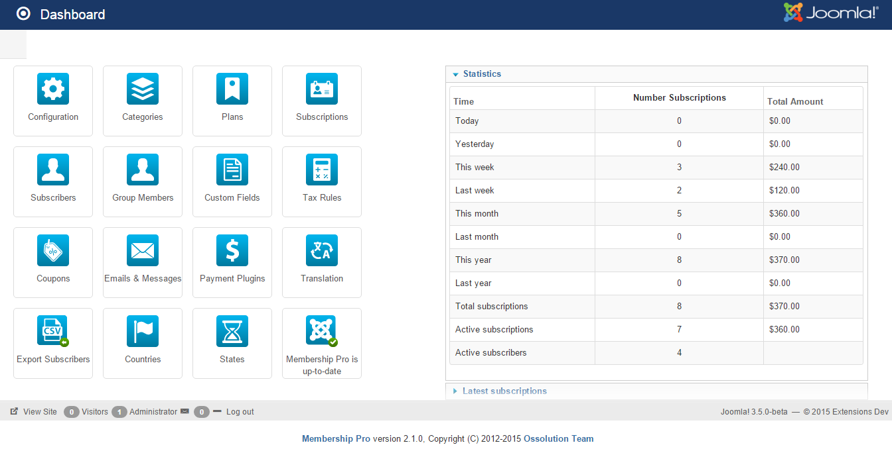

## Installation
When you purchase **Membership Pro** from our site, you receive an email with the **membershippro_unzip_first.zip** file. Extract it to find the **Language Packages** folder and the **com_osmembership.zip** file. The latter contains the component, modules, and plugins. Install it as you would any other Joomla extension.

1. Log in to the backend of your site using a super administrator account.
2. Go to the **Extensions -> Manage -> Install** menu item.
3. Browse for the file **com_osmembership.zip**.
4. Click the **Upload & Install** button

After installation, Joomla redirects you to the Membership Pro dashboard, where you can configure the extension.

## Check for new version

To check for updates, open **Membership Pro => Dashboard** and look at the update notification icon in the bottom-right corner, as shown below.

1. If you have the latest version, the dashboard shows **Membership Pro is up-to-date**. No update is required.
2. If an update is available, the dashboard shows a message such as **Membership Pro 2.1.0 Update now!**. Go to [https://joomdonation.com](https://joomdonation.com), log in to your account, and open [My Downloads](https://joomdonation.com/my-downloads.html). Download the latest version and follow the steps in the Upgrade section below.

## Upgrade
Follow the same steps as for a new installation, with these precautions.

1. Install the new version over the old one. If you uninstall the old version first, you will have to recreate the menu items that link to the extension.
2. Back up your site before updating so you can restore it if anything goes wrong. We recommend using [Akeeba Backup](https://www.akeebabackup.com/products/akeeba-backup.html) to create the backup.

### Use Joomla Update
**Membership Pro** allows you to use **Joomla Update** to update the extension whenever there is a new version release. To use **Joomla Update**, please follow the instructions below:

1. Go to [https://joomdonation.com/download-ids.html](https://joomdonation.com/download-ids.html), get **Download ID** of your account
2. Then go to **Membership Pro -> Configuration**, enter the received **Download ID** into **Download ID** config option.

When a new version of Membership Pro is released, Joomla shows a notification in the backend and on the Membership Pro dashboard. Follow the link in the notification to update from your site.

Generate a unique **Download ID** for each site. A single **Download ID** **can be used for all our products** on that site.

### Update Manually
If you need to update manually, for example if Joomla Update fails, log in to your account on our website and open **My Downloads** at [https://joomdonation.com/my-downloads.html](https://joomdonation.com/my-downloads.html). Download the latest version and follow the steps for a new installation.

## Uninstall
To uninstall Membership Pro, follow these steps.

1. Log in to the backend of your site using a super admin account
2. Access to Extensions => Manage => Manage menu item.
3. Enter membership keyword into the search box to search for membership pro component and all its modules, plugins (see the screenshot)
4. Check on the items you want to uninstall (look at Author column, it must be **Tuan Pham Ngoc** to make sure the extension belong to **Membership Pro** package)
5. Click the **Uninstall** button in the toolbar

>>>>> When you uninstall Membership Pro, the database tables related to the extension won't be uninstalled. By doing that, when you reinstall the extension in the future, all the old data will be kept and still be available. If you want to completely removing it, please access your site database via phpMyAdmin, look at all the tables with prefix **osmembership** and drop these tables

## Move data from one site to a new site
Follow these steps to move Membership Pro data to a new site.
1. Export all Membership Pro database tables (the tables with the **osmembership** prefix) from the old site and import them into the new site's database.
2. Migrate the Joomla user data as well. Export the following tables from the old site and import them into the new site's database. Use your site's table prefix in place of **jos**.
* **jos_usergroups**
* **jos_users**
* **jos_user_keys**
* **jos_user_notes**
* **jos_user_profiles**
* **jos_user_usergroup_map**
* **jos_viewlevels**
3. If the sites use different table prefixes, open the exported SQL file in a text editor such as Notepad++ before importing the data in steps 1 and 2. Replace the old site's table prefix with the new site's table prefix, then run the import.
4. Use phpMyAdmin to work with both sites' databases.