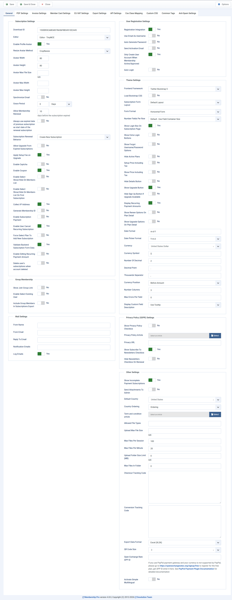

Membership Pro creates default settings during installation. Review them and adjust them as needed for your site.

Go to **Membership Pro** -> **Configuration** to open the screen shown below.

>>>>> Hover over the name of an option to see what it does.

The sections below explain the main settings. Contact us if you need help with an option that isn't covered here.

## Frontend Framework Configuration
Choose these settings based on the frontend framework used by your site template.

1. **Load Bootstrap CSS**: This should be set to **No** unless your site template is built base on a frontend framework not supported by Membership Pro (currently, Membership Pro supports **Bootstrap 4**, **Bootstrap 4* and **UIKIT3**).
2. **Frontend Framework** defaults to **Bootstrap 5**, which many Joomla templates use.
- If your site template is built with Bootstrap version 4, set it to Bootstrap 4.
- If your site template is built with Bootstrap version 5 set it to Bootstrap 5.
- If your site template is built with UIKIT3 (for example, Yootheme templates), set it to UIKIT3

### Use Bootstrap 4
Use these settings if your site template uses Bootstrap 4.

- Set **Load Bootstrap CSS** config option to **No*
- Set **Frontend Framework** config option to **Bootstrap 4**

### Use Bootstrap 5
Use these settings if your site template uses Bootstrap 5.

- Set **Load Bootstrap CSS** config option to **No**
- Set **Frontend Framework** config option to **Bootstrap 5**

### Use UIKIT 3
This will be used if your site template is built base on twitter bootstrap 5

- Set **Load Bootstrap CSS** config option to **No**
- Set **Frontend Framework** config option to **UIKIT 3**

## General

### Subscription Settings
1. With **Registration Integration** enabled, subscribers can enter a username and password to create a Joomla account when they sign up. An account lets them log in to access restricted resources, update their profile, renew, or upgrade. In most cases, **you should set this config option to Yes**. If you use Membership Pro only to collect payments, you can leave it disabled.
2. By default, Membership Pro creates a Joomla account as soon as a subscriber submits the subscription form, before processing payment. If the payment fails or the subscriber abandons it, the account remains blocked and the subscriber cannot use it to sign up again. We recommend setting **Only Create User Account When Membership Active/Approved** to **Yes** so Membership Pro creates the account only after the subscription becomes active through payment or administrator approval.
3. Set **Send Activation Email** to **Yes** if you want users to verify their email address by following an activation link. Set it to **No** if you want Membership Pro to activate accounts automatically after payment.
4. Set **Auto Login** to Yes to log subscribers in automatically after payment so they can access restricted resources immediately.
5. Set **Show Login Box On Subscription Page** to Yes to let existing customers log in directly from the subscription form. If **Registration Integration** is set to **Yes**, set this option to **Yes** as well.
6. By default, subscribers can renew as soon as they sign up. Enter a number of days in **Allow Membership Renewal X days before subscription expired** to allow renewal starting that many days before the subscription expires. This helps prevent subscribers from signing up for the same plan multiple times.
7. Set **Enable Captcha** to Yes to help prevent spam. Membership Pro uses Joomla's built-in captcha, so also configure the Joomla reCAPTCHA plugin. See [https://docs.joomla.org/How_do_you_use_Recaptcha_in_Joomla%3F](https://docs.joomla.org/How_do_you_use_Recaptcha_in_Joomla%3F) for instructions.
8. If you've set up coupons, set **Enable Coupon** to **Yes** so subscribers can enter a coupon code on the subscription form and receive a discount.
9. **Generate Membership ID**: If you want Membership Pro to generate an unique, auto-increment **Membership ID** for each subscriber, set this config option to **Yes**. If you do so, remember to remove and change the following config options to meet your need: **Membership ID prefix**, **Reset membership id every year**, **Membership ID start number**.  

### Theme Settings
1. **Show price including tax**: By default, Membership Pro display subscription plans price without tax. If you want to display price including tax (which is required by law in some country), set this config option to **Yes**.
2. **Date Format**: Enter the date format you want. It will be used to format the date displaying in the system. For list of supported parameter, please see [http://php.net/manual/en/function.date.php](http://php.net/manual/en/function.date.php) for list of supported parameters. 
3. **Date Custom Field Format**: Membership Pro allows you to create custom fields to collect more information of subscribers on subscription form. If you use **Date custom field**, you should change this config option to have the format you want.
4. **Currency Symbol**: It is $ by default. If you use different currency, you can change the currency here to meet your own currency. Please note that from version 2.1.0, each subscription plan can have it own currency and currency symbol.

### Mail Settings
1. **From Name**: The sender name uses to send emails in the system (to admin and subscribers). If you leave it empty, the **From Name** which is setup in Global Configuration of your site will be used.
2. **From Email**: The sender email uses to send emails in the system (to admin and subscribers). If you leave it empty, the **From email** which is setup in Global Configuration of your site will be used. 
3. **Notification emails**: The emails you want to receive notification when someone subscribes for a subscription plan on your site. If you want to user multiple emails, separate these emails by comman. For example: paypal@joomdonation.com,acounting@joomdonation.com
4. **Disable Admin Notification**: Sometime, you don't want to receive notification emails when someone signs up for your plan (likely when you only offer free subscription plans in your system). In that case, set this config option to **Yes** (it is **No** by default)

### Other Settings
1. **EU VAT Number field**: If you are from one of EU countries, you will need to setup a custom field in Membership Pro to allow subscribers to enter their VAT Number. In that case, please select that custom field which you created for this config option.
2. **Term and condition article**: If you need your subscribers to accept your terms and conditions to sign up for subscription plan, please create a temrs and conditions article, then select that article in the config option. When you select an article, the system will display a checkbox (has link to the selected article) and subscribers will have to check on that checkbox to agree on terms and conditions to complete the subscription. 

## Invoice Settings
1. **Activate Invoice Feature**: If you have paid subscription plans and want to send invoice PDF to your customers after they sign up and complete payment for the subscription, please set this config option to Yes.
2. **Send invoice to subscribers**: Set this config option to Yes if you want the system to send PDF invoice to subscribers in the confirmation email they received after signing up for your subscription plan. If you set to No, subscribers will have to access to their membership profile to download the invoice. This config option should be set to Yes if you use invoice feature.
3. **Send copy of invoice to administrators**: If you want to receive a copy of the PDF invoice send to subscriber (for managing purpose), you can set this config option to Yes
4. **Invoice Start Number**: If you want the invoice number in the system to start with a certain number (instead of starting by 1), you can enter that number into this config option.
5. **Invoice Format**: Membership Pro generates default basic invoice format when you first install the extension. You should review and change the invoice format to meet your need (at least you will have to change invoice logo)