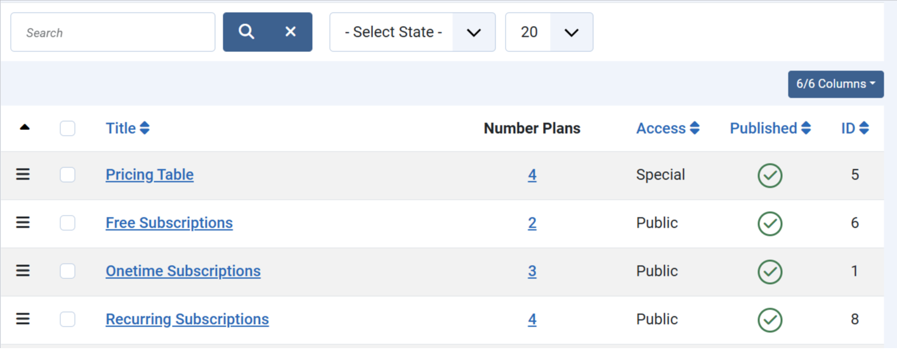
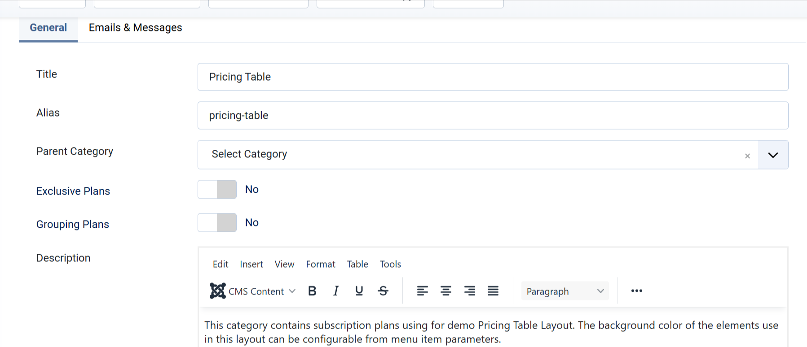

You can organize subscription plans in **Membership Pro** using as many categories and levels of subcategories as you need.

Categories are optional. Create them if you have many plans and need to organize them.

You can open the categories management page in three ways.

1. Go to **Membership Pro -> Categoires**.
2. Open the Membership Pro Dashboard and click the Categories icon.
3. From any Membership Pro page, go to **Setup => Categories**.

## Add new category
Click the **New** button in the toolbar to open the form for creating a category.

### General Information

<table class="table table-stripped table-bordered table-considered">
<thead>
<tr><th width="15%">Property</th><th>Description</th></tr>
</thead>
<tbody>
<tr>
<td><strong>Name</strong></td>
<td>Name (title) of the category. The name will be displayed to end-users.</td>
</tr>
<tr>
<td><strong>Alias</strong></td>
<td>Membership Pro uses the alias to build links to the category and its plans. If you leave it blank, Membership Pro generates one from the category name.</td>
</tr>
<tr>
<td><strong>Parent</strong></td>
<td>Select a parent category. Choose <strong>Select Category</strong> to make this a top-level category.</td>
</tr>
<tr>
<td><strong>Exclusive Plans</strong></td>
<td>If set to Yes, each user can have only one active subscription in this category. They can subscribe to another plan in the category after their current subscription expires.</td>
</tr>
<tr>
<td><strong>Grouping Plans</strong></td>
<td>If set to Yes, all plans in this category will be treated as a single plan. That mean when someone subscribes for a plan in this category, it will be treated as it he is renewing his subscription for subscriptions of other plans in that category.</td>
</tr>
<tr>
<td><strong> Access</strong></td>
<td>Select the access level for this category, usually Public. Only users with that access level can see the category.</td>
</tr>
<tr>
<td><strong>Description</strong></td>
<td>The description appears on the categories list page.</td>
</tr>
</tbody>
</table>

### Emails & Messages
In **Membership Pro**, category-specific Emails & Messages override the global settings. A message configured for a plan takes priority over both. Membership Pro looks for the message in this order.

- If the message is configured for the plan, use that message.
- Otherwise, use the message configured for the category if one is available.
- Otherwise, use the global Emails & Messages setting.

