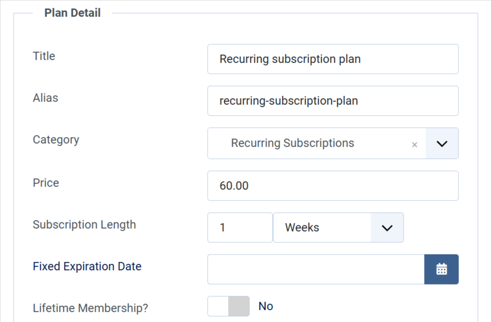

Click New in the toolbar to open the form for creating a subscription plan.

### Basic Information

<table class="table table-bordered table-stripped table-considered">
<thead>
<tr><th width="15%">Property</th><th>Description</th></tr>
</thead>
<thead>
<tr>
<td><strong>Title</strong></td>
<td>Title of the subscription plan.</td>
</tr>
<tr>
<td><strong>Alias</strong></td>
<td>Membership Pro uses the alias to build the URL for the plan details page. Leave it blank to generate an alias from the plan title.</td>
</tr>
<tr>
<td><strong>Category</strong></td>
<td>Select a category for the plan. Categories are optional. If you haven't set up categories, leave this field blank.</td>
</tr>
<tr>
<td><strong>Price</strong></td>
<td>Enter the price subscribers pay to sign up. For a free plan, enter 0 or leave this field blank.</td>
</tr>
<tr>
<td><strong>Subscription Length</strong></td>
<td>
The length of time a subscription stays active after sign-up. You can specify a number of days, weeks, months, or years.
</td>
</tr>
<tr>
<td><strong>Expired Date</strong></td>
<td>

Set a fixed expiration date if all subscriptions to the plan should expire on the same date regardless of when subscribers sign up. The example below uses 31/12/2015.

<ul>
<li>
If users sign up before 31/12/2015, their subscription expires on <strong>31/12/2015</strong>.
</li>
<li>
If users sign up after 31/12/2015, for example on 06/05/2015, their subscription will be expired in <strong>31/12/2016</strong>
</li>
</ul>
</td>
</tr>
<tr>
<td><strong>Lifetime Membership</strong></td>
<td>Set this field to Yes to keep subscriptions active indefinitely. The default is No, so subscriptions expire based on the Subscription Length.</td>
</tr>
<tr>
<td><strong>Thumbnail</strong></td>
<td>Upload an optional thumbnail to display in the plans list and on the plan details page.</td>
</tr>
<tr>
<td><strong>Send First Reminder</strong></td>
<td>Enter <strong>X</strong> to send the first reminder email <strong>X</strong> days before a subscription expires. Configure the message under Membership Pro => Emails && Messages. To disable this reminder, enter 0 or leave the field blank.</td>
</tr>
<tr>
<td><strong>Send second Reminder</strong></td>
<td>
Enter <strong>Y</strong> to send the second reminder email <strong>Y</strong> days before a subscription expires. To disable this reminder, enter 0 or leave the field blank.
</td>
</tr>
<tr>
<td><strong>Send Third Reminder</strong></td>
<td>
Enter <strong>Z</strong> to send the third reminder email <strong>Z</strong> days before a subscription expires. To disable this reminder, enter 0 or leave the field blank.
</td>
</tr>
<tr>
<td><strong>Enable Renewal</strong></td>
<td>

Set this field to <strong>Yes</strong> to let subscribers renew before, on, or after the expiration date. Set it to No for a free trial plan if subscribers should be unable to renew after the trial expires.

</td>
</tr>
<tr>
<td><strong>Short description</strong></td>
<td>The short description appears in the plans list.</td>
</tr>
<tr>
<td><strong>Description</strong></td>
<td>The full description appears on the plan details page. If you leave this field blank, Membership Pro uses the short description.</td>
</tr>
</thead>
</table>

