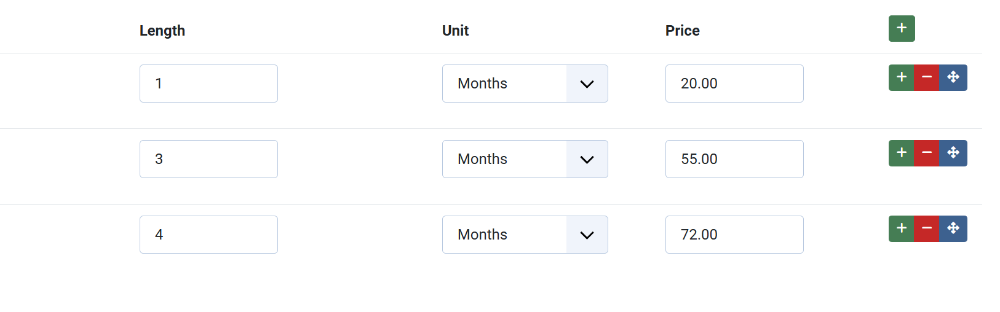

If you enable renewals for a subscription plan, subscribers can renew their membership to remain active.
1. If you don't configure renewal options, subscribers pay the plan price to renew. Their subscription is extended by the plan's subscription length, specified in days, weeks, months, or years.
2. If you configure renewal options, subscribers can choose a price and duration when they renew. Shorter periods can cost less, and longer periods can cost more. For example, for a three-month plan priced at $60, you could offer these renewal options.
* Renew for one month at $20.
* Renew for three months at $55. The discount encourages longer renewals.
* Renew for four months at $72.

