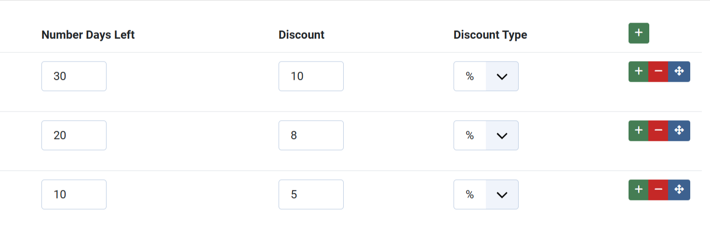

Use **Early Renewal Discounts** to offer subscribers a discount when they renew before their subscription expires.

1. Edit the subscription plan, look at **Renew Options** tab, Early **Renewal Discount Options** section.
2. Add any number of rearly renewal discount options you want for that plan (see the screenshot below). In this example, if someone renews his subscription 30 days before expiring, he will get 10% discount. If he renews 20 days before expiring, he will get 8% discount, and if he renews 10 days before expiring, he will get 5$ discount (discount can be a fixed amount or by percent).

