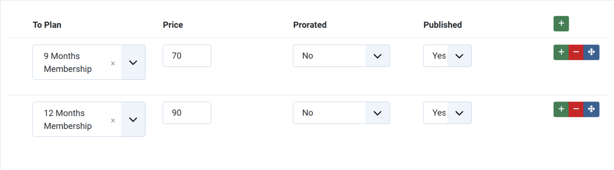

You might want to give users the option to **upgrade** their membership from a subscription plan with **lower prority** (access to less resources in less time) to other subscription plan with higher priority (access to more resources in a longer time). For example, upgrade from **3 Months Memebership** to **6 Months Memebership** or **12 Months Memebership**. In this case, you can add upgrade options when you add / edit subscription plan as you see in this screenshot:

## Add upgrade options
To add upgrade options, in add / edit subscription plan plage, look at **Upgrade Options** tab and add the upgrade options you want. For each upgrade option, you need to select the plan which subscribers of this plan can upgrade their membership to and enter the price of the upgrade. You can

>>>Currently, **upgrade from a recurring subscription plan to another recurring subscription plan is only supported for Stripe payment plugin**. The reason is because to perform upgrade from plan A to plan B, we first need to cancel the recurring subscription for plan A. However, most of payment gateways such as PayPal doesn't have API allows us to do that, so for these gateways, it could not be implemented.

## Upgrade pro-rated explanation
In Membership Pro, when subscribers upgrade from plan A to plan B:

1. The system will create a new subscription record for plan B.
2. The subscription record for plan A will be marked as expired.

Since the subscriptin record for plan A is marked as expired, subscribers loose their current active subscription duration, thus they would hesitate to update and might wait until their current subscription expires before upgrade to new (usually higher level plan, for example, hgiher subscription length).**Prorated upgrade option** was introduced starting with version 2.7.0 to address this limitation. When you add upgrade options, you can select an option for **Prorated**:

1. **No**: Nothing special. Upgrade will be processed normally.
2. **By Time**: If this option is selected for the upgrade option, when subscribers upgrade their membership using this upgrade option, the remaining time from his original subscription will be added to the upgrade option. For example, if his orignal subscription has 20 days remaining and he upgrade to a 3 Months subscription plan, the upgrade subscription will have duration 3 Months 20 days.
3. **By Price**: If this option is selected for the upgrade option, when subscribers upgrade their membership using this upgrade option, the remaining money from his original subscription (Calculated by this formula: **PRICE_OF_ORIGINAL_PLAN \* NUMBER_DAYS_LEFT/SUBSCRITPION_LENGTH_IN_DAYS**) will be deducted from the price of the upgrade option. For example, if his orignal subscription has subscription length 30 days, the price is 30$ and he has 10 days left, then he will have 10$ left from his original subscription. If the upgrade option costs 50$, he will only have to pay 40$ (50$ - 10$) when perform upgrade.
4. **Keep Duration**: If this option is selected for the upgrade option, when subscribers upgrade their membership using this upgrade option, the subscription end date of his upgraded subscription will be the same with subscription end date of his original subscription.
5. **Keep duration, price prorated from original plan**: If this option is selected for the upgrade option, when subscribers upgrade their membership using this upgrade option, the subscription end date of his upgraded subscription will be the same with subscription end date of his original subscription. The money which users have to pay will be calculated by this formula: **PRICE_OF_ORIGINAL_PLAN \* NUMBER_DAYS_LEFT/SUBSCRITPION_LENGTH_OF_ORIGINAL_PLAN_IN_DAYS**
6. **Keep duration, price prorated from upgrade plan**: If this option is selected for the upgrade option, when subscribers upgrade their membership using this upgrade option, the subscription end date of his upgraded subscription will be the same with subscription end date of his original subscription. The money which users have to pay will be calculated by this formula: **PRICE_OF_UPGRADED_PLAN \* NUMBER_DAYS_LEFT/SUBSCRITPION_LENGTH_OF_UPGRADED_PLAN_IN_DAYS**

