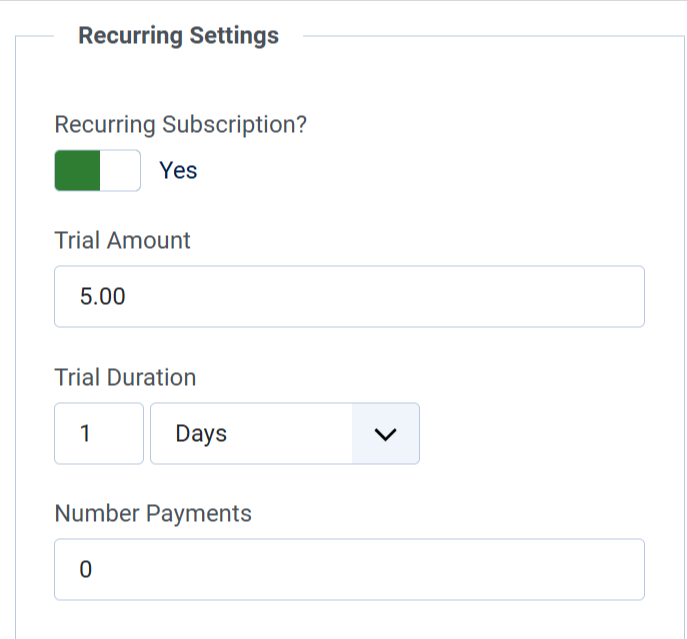

Membership Pro supports recurring subscriptions. When someone signs up for a recurring subscription plan, it renews automatically until they cancel it or the number of renewals reaches the **Number Payments** value the administrator set for the plan.

To make a plan become recurring subscription plan, you need to set **Recurring Subscription** property of that plan to **Yes**. There are addition parameters which you can setup for a recurring subscription plan as explained below:

1. **Trial Duration**: If you to give subscribers of this subscription plan a trial duration, setup the trial duration here. Usually, trial duration should be shorter than subscription length, it could be X days/ weeks / months / years. When setup trial duration, you will need to determine the trial price which subscribers will have to pay for that trial duration, too.
2. **Trial amount**: This is the price subscribers have to pay for the trial duration you setup above. You you want to have free trial, you can set Trial amount to 0 (or leave it empty) 
3. **Number Payments**: If you want the subscription ends after certain number of payments, you can enter **Number Payments** here. Otherwise, leave it empty and the renewal will continue happens unless subscribers or administrator cancel it.