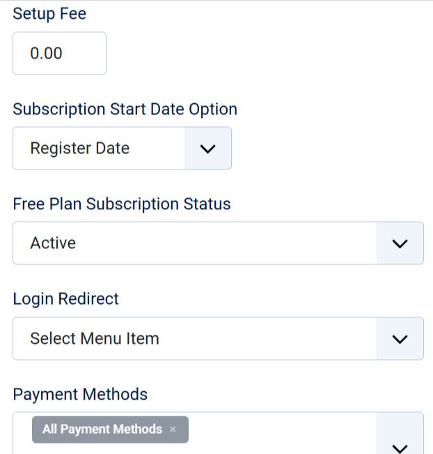

The **Advanced Settings** section allows you to setup some settings which only be applied for this specific subscription plan. You can ignore the settings in this section and the global configuration options will be used.

| Property | Description |
| ------ | ----------- |
| **Max number of group members**   | Maxium number of group members which group admin can add to his group. You will only have to make this setup if you are using **Group Membership** feature. We will describe in in a separate section in the document.|
| **Login Redirect** | Select a menu item which subscribers of this plan will be redirected to when they login. If you want to use this feature / option, make sure you publish the plugin **User - Membership Pro** |
| **Payment Methods**    | Select the payment plugins you want to be available for this plans. If you don't select any payment methods, in the published payment plugins will be available. |
| **Currency**    | If you want this plan to use a different currency than other plans - currently only wors with Paypal, you can select the currency you want to use here. If you select currency, please also enter **Currency Symbol** for this plan, too. |
| **Subscription complete url (optional)**    | By default, Membership Pro will redirect subscribers to default subscription complete page which display subscription information. If you want subscribers of this plan to be redirected to a specific page on your site after completing the subscription, you can enter the URL of that page into that field |
| **Notification emails**    | Enter the emails you want to receive notification when someone sign up for this plan. If you leave this field empty, the notification emails which you entered in Configuration will be used. |
| **Paypal Email**    | Enter the paypal email which you want to receive payment when someone sign up for this plan. Leave it empty to use the Paypal account which you entered in Paypal payment plugin |
| **Term and condition article**    | Select terms and conditions article you want to use for this plan. If you don't select, the terms and conditions article which you select in Configuration will be used|