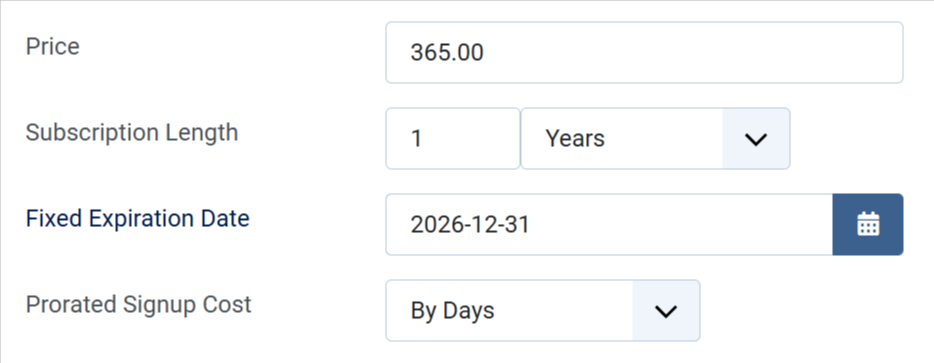

On many membership website, you have plans with fixed expiration date. For this kind of plans, all subscriptions will be expired on the same date (for example, 12-31-2026), no matter what dates subscribers sign up. By default, subscribers will have to pay full price of the subscription plan, even if there is only one or two months left for the subscription

If you want to change this default behavior, you can set **Prorated Signup Cost** of the plan to **By Days** or **By Months**:

* If you set it to **By Days**, when subscribers sign up, the system will calculate the remaining days of the subscription (For example, today is **11-16-2026** and if fixed expiration date set to **12-31-2016**, the the remaining days would be **45 days**) and multiple with the price for each day to calculate the subscription price subscribers have to pay (instead of asking subscribers to pay for full price). So for example, if price of the plan is 365$ (1$ each day), the subscribers will only have to pay 45$ instead of 365$. If someone subscribes on tomorrow, he will have to pay 44$ and so on....
* If you set it to **By Months**, when subscribers sign up, the system will calculate the remaining months of the subscription (For example, today is **11-16-2026** and if fixed expiration date set to **12-31-2026**, the the remaining months would be **2 months**) and multiple with the price for each month to calculate the subscription price subscribers have to pay (instead of asking subscribers to pay for full price). So for example, if price of the plan is 120$ (10$ each month), the subscribers will only have to pay 20$ instead of 120$. If someone subscribes on next month, he will have to pay 10$ and so on....

