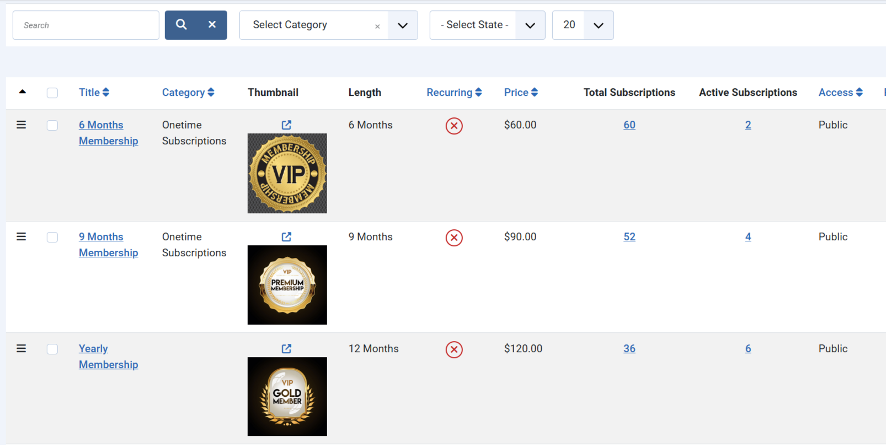

Subscription plans are what you sell to your customers. After you set up your plans, customers can browse them on your site, choose a plan, and complete any required payment to activate their subscription.

Base on the **price** of subscription plans, Membership Pro supports the following subscription plans type

1. **Free subscription plans**
2. **Onetime payment subscription plans**
3. **Recurring Subscription plans**
4. **Recurring Subscription plans with trial duration** (can be free trial)

Base on the **subscription length**, we can divide subscription plans into the two types below:

1. **Fixed subscription length** (for example **15 days**, **1 month**, **3 months**, **1 year**). For this type of subscription plans, when subscribers sign up, their subscription will be expired after the subscription length you defined for the plan.
2. **Fixed Expiration Date**. For this type of subscription plans, when subscribers sign up, their subscriptions will be expired at a fixed date (for example 31 December 2016), not depend on the date they sign up. Of course the extension is smart enough so that if users sign up after that fixed date, their expiration date will be changed to next year. For example, if you set **Expiration Date** of the plan to **31 Decemmber 2015** and users sign up at **sometime in 2016**, their subscription will be expired on **31 December 2016**. So in this case, you won't have to change setting of the plan every year.

To open categories management page, there are 3 different ways:
1. Access to **Components -> Membership Pro -> Subscription Plans**.
2. Access to Membership Pro Dashboard, then click on Plans icon
3. On any pages in Membership Pro, access to **Setup -> Plans**

