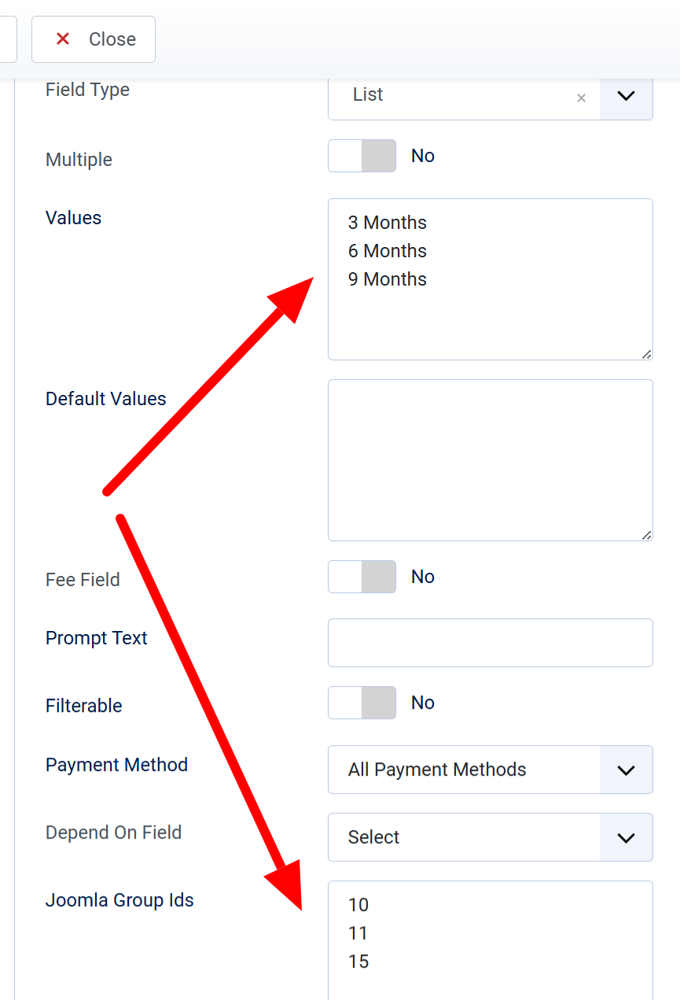

**Membership Pro** can assign subscribers to Joomla user groups based on the value they select for a custom field during the subscription process. For example, if you create a **Membership Option** field, selecting **3 Months** can assign a subscriber to the **3 Months Membership** user group, while selecting **6 Months** can assign them to the **6 Months Membership** user group. Follow these steps to configure the field.

1. Go to Users => Groups and create three Joomla user groups: **3 Months Membership**, **6 Months Membership**, and **9 Months Membership**. This example uses group IDs **10, 11, 15**.
2. Go to **Membership Pro => Custom Fields**, create a custom field with following important settings:
* **Field Type**: **List** or **Radio**
* **Values**: **3 Months**, **6 Months**, **9 Months** (each value in one line)
* **Joomla Group Ids**: **10**, **11**, **15** (each value in one line)

Please note that there is a mapping 1;1 between the value of an option with ID of the Joomla User Group which subscribers will be assigned to when they select that option.

