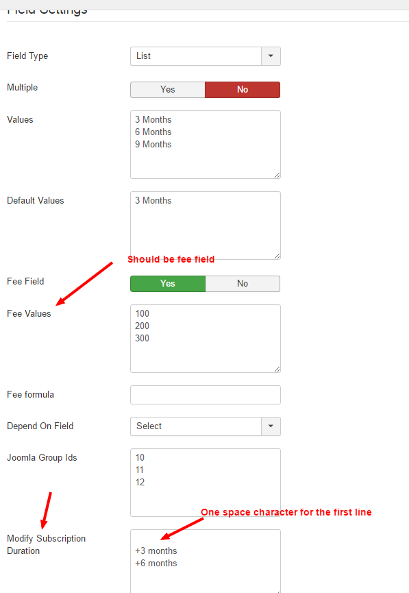

Sometimes, you might want to offer different subscription length options for the same subscription plan. For example, you create a **3 Months** subscription plan but want to allow your subscribers to choose other options such as 6 Months, 9 Months.. then they sign up for that plan. To do that, you can use **Modify Subscription Duration** feature of custom field which is supported starting with version 2.7.0

Go to Membership Pro => Custom Fields, create a new custom field with below important settings:

1. **Name** : osm_subscription_option (of course, you can use any name you want)
2. **Title**: Subscription Option (or any title you want)
3. **Values**: **3 Months**, **6 Months**, **9 Months** (each value in one line)
4. **Modify Subscription Duration**: **SPACE_CHARACTER**, **+3 months**, **+6 months** (each option in one line)
* **SPACE_CHARACTER** is just a space character. Since the original subscription plan has subscription length set to 3 Months already, of subscribers choose 3 Months option, there will be no modification to subscription end date needed
* If users choose **6 Months** option, we need to add extra 3 months to the original subscription (because the plan has 3 months membership already), thus the need to use **+3 months** instead of **+6 months**
* If users choose **9 Months** option, we need to add extra 6 months to the original subscription (because the plan has 3 months membership already), thus the need to use **+6 months** instead of **+9 months**

Some notes if you use this feature/option:
1. This should be a custom fee field. If subscribers choose a longer subscription option, they should have to be charged more money
2. You can use string such as +3 days, +5 weeks, +1 year, +2 years... in **Modify Subscritpion Duration** setting of the custom field

 

