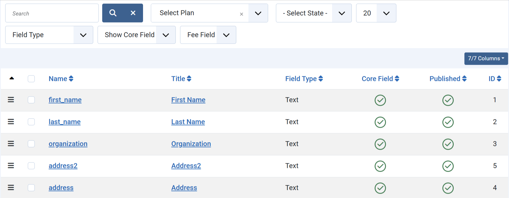

**Custom fields** appear on the subscription form and collect information from subscribers when they sign up for a plan.

When you install Membership Pro, it creates these **core fields** by default: **First Name**, **Last Name**, **Organization**, **Address**, **Address2**, **City**, **State**, **Zip**, **Country**, **Phone**, **Fax**, **Email**, and **Comment**.

You can open the custom fields management page in three ways.

1. Access to **Components -> Membership Pro -> Custom Fields**.
2. Access to Membership Pro Dashboard, then click on **Custom Fields** icon
3. On any pages in Membership Pro, access to **Setup -> Custom Fields**

Common tasks for configuring the fields on your subscription form include the following.
1. **Change title of the field**. In this case, just edit the custom field, change the title to meet your need and save it.
2. **Show / Hide** some of the existing custom fields on subscription form. In that case, just **Publish / Unpublish** the field you want.
2. **Make some fields become required / optional**. If so, just edit the custom field, set **Require** property to **Yes / No**.
3. **Add new custom fields**. In that case, just press New button in the toolbar to add new field.
4. **Change ordering of the custom fields**. In that case, just drag & drop the field to the position you want (same with Joomla core)