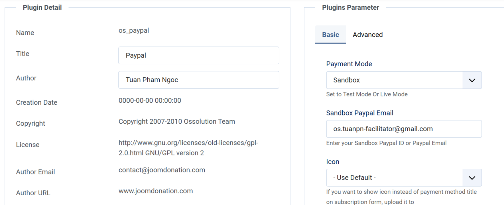
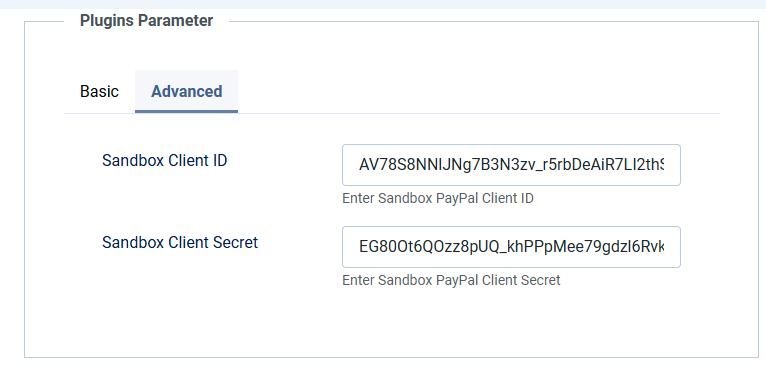
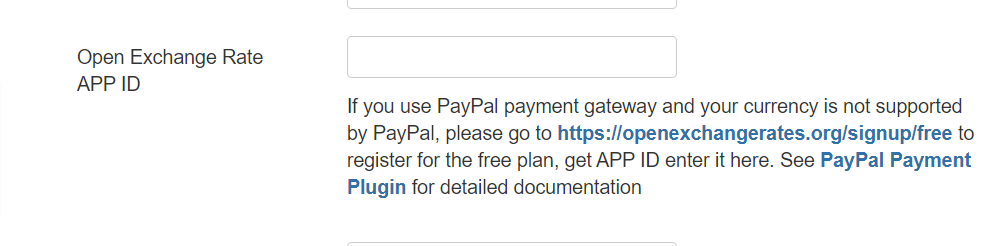

On Payment Plugins management screen, click on **os_paypal** payment plugin to edit it. The following parameters need to be configured:

1. **Payment Mode**: Set to **Sandbox** (for testing payment) or **Live Mode** (for real payment).
2. **Paypal Email**: Enter the PayPal Email associated with your PayPal account.
3. **Icon**: If you want to display an icon instead of title of payment method, choose the icon you want to use from the dropdown
4. **Payment Processing Fee ($)**: If you want subscribers to pay for payment processing fee (a fixed fee amount), enter that fee into this parameter.
5. **Payment Processing Fee (%)**: If you want subscribers to pay for payment processing fee (a percent fee amount), enter that fee into this parameter.

## Advanced Settings
If you have a business PayPal account, you can follow the instructions at [https://developer.paypal.com/api/rest/#link-getclientidandclientsecret](https://developer.paypal.com/api/rest/#link-getclientidandclientsecret) , get **Client ID**, **Client Secret** of your PayPal account, enter it into os_paypal payment plugin parameters (Advanced tab) to allow:

- Subscribers to cancel recurring subscription from their account
- Admin can refund for a subscription from administrator area of the site

## Recurring Settings Notes
If you are using recurring subscriptions with PayPal payment plugin, please note that PayPal has some restrictions related to subscription length:

- If **Subscription Length** is **Days**, the value will have to be from **1 to 90**. Sometime, you set it to 365 Days and PayPal does not allow that, you will have to change it to 1 Year instead
- If **Subscription Length** is **Weeks**, the value will have to be from **1 to 52**
- If **Subscription Length** is **Months**, the value will have to be from **1 to 24**
- If **Subscription Length** is **Years**, the value will have to be from **1 to 5**

## Enable PayPal IPN
In some special cases, PayPal IPN might be disabled in your PayPal account. If you want to enable IPN (usually when being asked by our support staff during support), please follow instructions at [PayPal IPN Setup](https://developer.paypal.com/docs/api-basics/notifications/ipn/IPNSetup/#setting-up-ipn-notifications-on-paypal) to enable PayPal IPN for your PayPal account. PayPal will ask you for IPN URL, just enter URL of your site into that field (for example https://domain.com/index.php - replace https://domain.com with URL of your site)

## IPN Trouble Shooting Instructions
Sometime, PayPal is not working on your site and our support team will have to ask you for help to check this issue. Usually, you will have to:

- Login to your administrator area of your site, access to **Membership Pro** -> **Payment Plugins**, click on **os_paypal** payment plugin to edit, set **Enable Log** parameter to Yes.
- Subscribe for the plan, make payment.
- Login to the PayPal account which receives payment, access to IPN History Page [https://www.paypal.com/cgi-bin/webscr?cmd=_display-ipns-history](https://www.paypal.com/cgi-bin/webscr?cmd=_display-ipns-history) 
- Find the IPN message related to that payment, click on it to edit, make a screenshot of that IPN message details
- Send us that screenshot via support ticket
- Base on the received information, we will guide you to check it further

## Requirements
- Your site must be on public accessible server. For example, if your site is on local computer, it won't work (because PayPal could not reach your local computer to inform Membership Pro about the payment
- Your site must be online mode. If you set your site to offline mode, it won't work because PayPal could not inform Membership Pro about the payment.
- In case frontend of your site is protected (by .htaccess password for example) to prevent public users to access (this usually happens during development period), PayPal won't work, too, because PayPal could not inform Membership Pro about the payment.

## Test PayPal account
If you want to test PayPal payment but don't want to register for a sandbox PayPal account yourself, you can use mine:

- Seller account (enter into os_paypal payment plugin to receive payment): thucdam84-facilitator@yahoo.com 
- Buyer account (can be used to login to PayPal when you are being redirected to PayPal for processing payment): thucdam84-buyer@yahoo.com / dangthucdam 

## Use PayPal With None Supported Currency
PayPal only supports certain currencies listed here [Supported Currency](https://developer.paypal.com/docs/reports/reference/paypal-supported-currencies/) . If your site uses a currency not supported by PayPal, Membership Pro needs to convert the payment amount from your currency to USD before passing to PayPal for processing payment. To do that, Membership Pro relies on a service called [https://openexchangerates.org/](https://openexchangerates.org/) for currency converter. To use that service, you will need to:

1. Go to [https://openexchangerates.org/signup/free](https://openexchangerates.org/signup/free) , register for a free account
2. Check your email to get APP ID or login and access to [https://openexchangerates.org/account/app-ids](https://openexchangerates.org/account/app-ids) , enter it into **Open Exchange Rate APP ID** config option of Membership Pro

