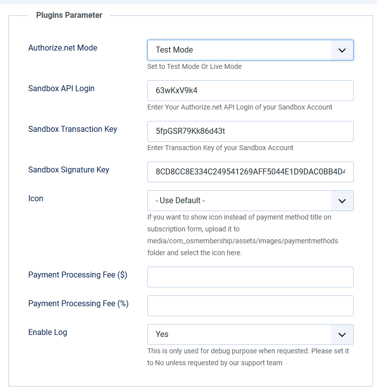
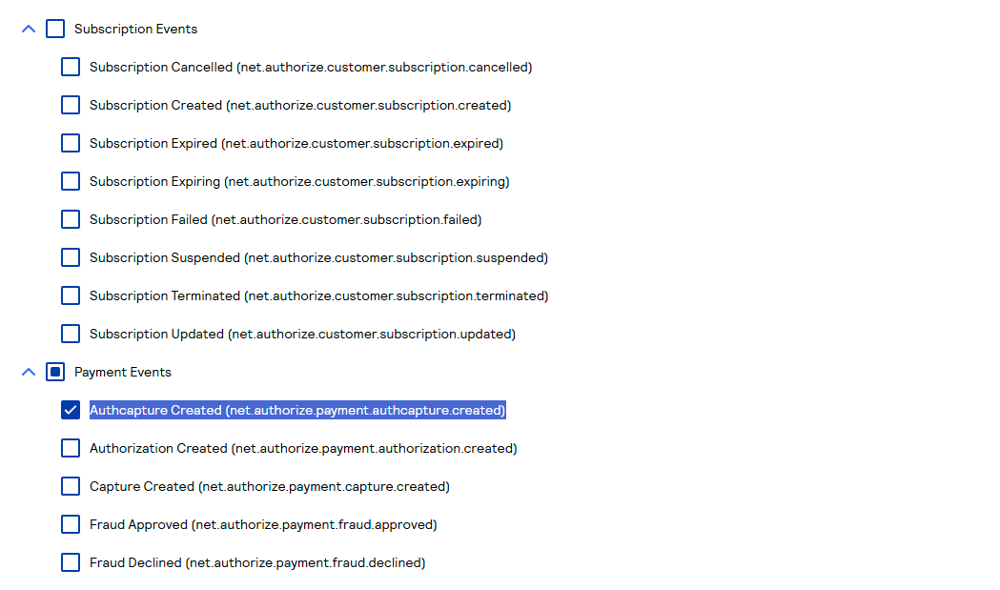

## Configure Plugin Parameters
Login to your authorize.net account, access to **Account** -> **Account and API Settings**  -> **API Credentials and Keys**. Get API Login, Transaction Key (generate it if needed), Signature Key (generate if needed) and enter it to Associated parameters in the **os_authnet** payment plugin parameters.

1. **Authorize.net Mode**: Set to **Test Mode** if you are testing the system and set it to **Live Mode** when you go live.
2. **API Login**
3. **Transaction Key**
4. **Signature Key** (this parameter is needed if you have recurring subscription plans)

Sometime, your Authorize.net might not work well in Test Mode. But it does works in Live Mode. In that case, if you want to test it in test mode, you can use the following Authorize.net account for testing purpose:

1. **API Login**: 2Sht9m67PD
2. **Transaction Key**: 35J2rq5d6LtJ2Yg6

## Configure Webhook
If you have recurring subscription plans, you will need to configure webhook so that each time Authorize.net charges users for recurring payment, Membership Pro will be informed about the charge and extends/renews subscription for user.  Access to **Account** -> **Account and API Settings**  -> **API Credentials and Keys** -> Webhooks, create a new webhook
- The webhook URL is https://yourdomain.com/mp_authnet_webhook.php (replace https://yourdomain.com with URL of your site)
- Select event **Authcapture Created (net.authorize.payment.authcapture.created)** for the webhook

## Configure Slient Post URL

If you use older version of Membership Pro (4.4.2 and older), it does not support webhook yet. So you will need to configure Slient Post URL for it to work. Set set **Slient Post URL** of your authorize.net account to http://domain.com/index.php?option=com_osmembership&task=recurring_payment_confirm&payment_method=os_authnet. Of course, you need to replace domain.com with your site domain. You can follow the instruction at [https://support.authorize.net/knowledgebase/Knowledgearticle/?code=000001399](https://support.authorize.net/knowledgebase/Knowledgearticle/?code=000001399) to setup silent post URL in your Authorize.net account.

Keep in mind that Slient Post URL is not reliable. So unless you are using Joomla 3, better update to latest version of Membership Pro to use webhook to make recurring subscription works reliable.

