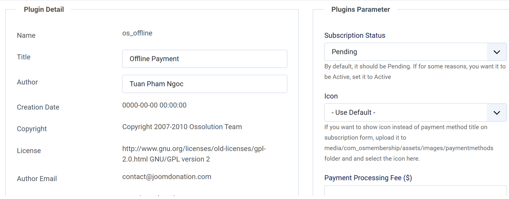

**Offline payment** plugin is a special payment plugin comes with the extension. It allows subscribers to make payment for the subscription later (not at the time they signup for the subscription plan) by bank transfer, by cash...

When subscribers choose offline payment for the subscription, the system will mark the subscription status as **Pending**. It will also display a message which guide users how to make payment.... This guide will also be sent to them via email

After receiving payment from subscriber for the subscription, admin will login to backend of the site, click on the subscription record, change the status from **Pending** to **Active**. At that time, the user will become an active subscriber and can access to restricted resources which only available for subscribers

If you use **Offline Payment** on your site, please go to Membership Pro => Emails & Messages, find and change the following messages to meet your need (mostly guide users how to send payment to you)

1. In **General Messages** tab, find and change **User email body (offline payment)** and **Thank you message (offline payment)** messages.
2. In **Renewal Messages** tab, find and change **Subscription renewal user email body (offline payment)** and **Subscription renewal thanks message (offline payment)** message	

Go to Membership Pro -> Payment Plugins, click on **os_offline** payment plugin to edit and configure it parameters. By default, when subscribers choose to use this payment method, their subscription status will be Pending. If for some reasons, you want Subscription status set to Active instead (although actual payment has not received yet), you can set **Subscription Status** parameter in the payment plugin to **Active**

## Additional Offline Payment Plugins

Membership Pro has one offline payment plugin comes with it by default. Sometime, you would need additional offline payment plugins, if so, you can download it from the links below to install and use it.

When you use additional offline payment plugins, each of these offline payment plugins can have it own messages if needed. If you don't setup separate messages for each of the additional plugin, the general offline payment messages will be used.

[os_osm_offline1.zip](os_osm_offline1.zip)

[os_osm_offline2.zip](os_osm_offline2.zip)

[os_osm_offline3.zip](os_osm_offline3.zip)

[os_osm_offline4.zip](os_osm_offline4.zip)

[os_osm_offline5.zip](os_osm_offline5.zip)

[os_osm_offline6.zip](os_osm_offline6.zip)

[os_osm_offline7.zip](os_osm_offline7.zip)

[os_osm_offline8.zip](os_osm_offline8.zip)

[os_osm_offline9.zip](os_osm_offline9.zip)