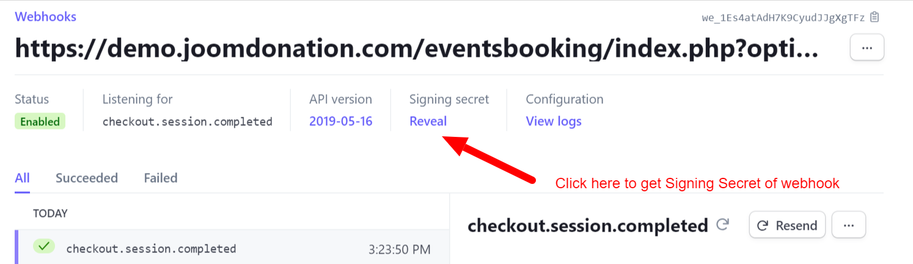

## Installation
When you purchase the payment plugin, you will receive a zip file called **os_osm_stripecheckout_unzip_first.zip**. Unzip that file, you will get the file os_osm_stripecheckout.zip. Go to Membership Pro -> Payment Plugins to install it as any other payment plugin. See [https://docs.joomdonation.com/membershippro/basic-setup/payment-plugins#install-new-payment-plugin](/basic-setup/payment-plugins#install-new-payment-plugin) for installation instructions if needed.

## Configuration
1. Click on the payment plugin to edit, enter payment plugin parameters, then publish it

- For API Keys, you can follow instructions at https://stripe.com/docs/keys#api-keys to get it.
- For Signing Secret, you need to setup Webhook URL (see the next step) and get the information from there. In the webhook URL setting, click the **Reveal** button to get it (see the screenshot at the end for more details)

2. You will need to log in to your Stripe account, add a "Webhook URL" below (see https://stripe.com/docs/webhooks/setup#add-endpoint-dashboard for instructions)

**https://domain.com/index.php?option=com_osmembership&task=recurring_payment_confirm&payment_method=os_stripe**

(Of course, need to replace **https://domain.com/** with your website url)

Stripe will also asks you for the events for webhook, select two events below:

**checkout.session.completed**

**invoice.payment_succeeded**

