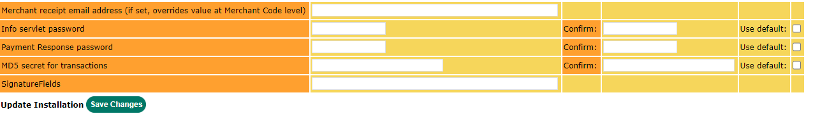

If you are using Worldpay payment plugin, you will need to make some changes in the settings of your Worldpay account. The steps are:

1. Login to merchant account at worldpay, edit the installation, in the Payment Response URL textbox, enter **YOUR_SITE_URL/index.php?option=com_osmembership&task=payment_confirm&payment_method=os_worldpay&notify=1**, for example, **https://joomdonation.com/index.php?option=com_osmembership&task=payment_confirm&payment_method=os_worldpay&notify=1**
2. Check on **Payment Response enabled** checkbox

### Enhance security with MD5

See http://support.worldpay.com/support/kb/bg/htmlredirect/Content/rhtml/Enhance_security_with_MD5.htm  for detailed explanation of the feature of WorldPay. To use that feature :

1. Edit your WorldPay installation, set :

- **MD5 secret for transactions** to the random string you want
- **SignatureFields** to **instId:amount:currency:cartId**

2. Then edit the os_worldpay payment plugin, set **MD5 Secret** parameter to the MD5 secret you entered in your WorldPay installation

