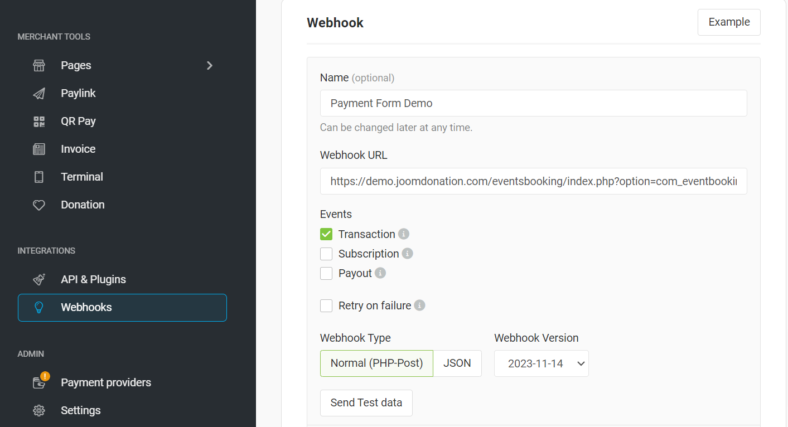

## Installation
When you purchase the payment plugin, you will receive a zip file called **os_osm_payrexx.zip**. Go to Membership Pro -> Payment Plugins to install it as any other payment plugin. See [https://docs.joomdonation.com/membershippro/basic-setup/payment-plugins#install-new-payment-plugin](/basic-setup/payment-plugins#install-new-payment-plugin) for installation instructions if needed.

## Configuration
1. Click on the payment plugin to edit, enter payment plugin parameters, then publish it

- **Instance Name**: This is is a part of the url where you access your Payrexx installation. For example, if the URL of your payrexx installation is https://joomdonation.payrexx.com, then **joomdonation** is **Instance Name**.
- **API Key** : Log in to your payrexx installation, access to Integrations -> API & Plugins and get API Key from there.

2. You will also access to **Integrations -> Webhooks** and setup webhook with the following settings:

- **Webhook URL** : https://domain.com/index.php?option=com_osmembership&task=payment_confirm&payment_method=os_payrexx

(Of course, need to replace https://domain.com/ with your site url)

- **Events**: Only select **Transactions**

- **Webhook Type**: Select **Normal (PHP-Post)**

