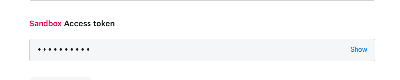
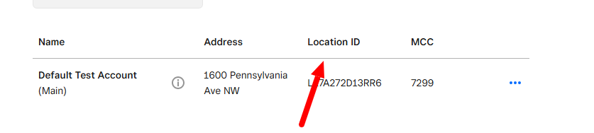
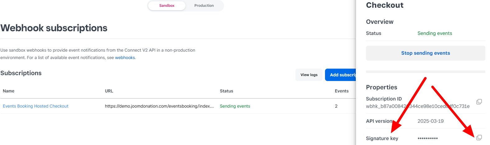

## Installation
When you purchase the payment plugin, you will receive a zip file called **os_eb_squarehostedcheckout.zip**. Go to **Membership Pro** -> **Payment Plugins** to install it as any other payment plugin. See [https://docs.joomdonation.com/membershippro/basic-setup/payment-plugins#install-new-payment-plugin](https://docs.joomdonation.com/membershippro/basic-setup/payment-plugins#install-new-payment-plugin) for installation instructions if needed.

## Configuration

1. Create a Square APP

- Go to https://developer.squareup.com/console/en/apps
- Create an app if you don't already have one for Membership Pro on your site.
- Select the app to open it.

2. Enter necessary payment plugins parameters

Go to **Membership Pro** -> **Payment Plugins**, click on **os_squarehostedcheckout** payment plugin to edit and enter the following parameters:

- **Access Token**: Copy the access token from the app.

- **Location ID**: Open **Locations** in the app's sidebar and copy the location ID.

- **Signature Key**: Copy the signature key from the webhook you create in the next step.

- **Order Prefix**: This is optional. Enter a prefix if you want the payment note sent to Square to be unique.

3. Create Webhook

Inside the app, from left menu, go to **Webhooks >> Subscriptions**, and add a new webhook subscription

- **Webhook URL** : **https://domain.com/index.php?option=com_osmembership&task=payment_confirm&payment_method=os_squarehostedcheckout**

(Of course, need to replace https://domain.com/ with your site url)

- **Events**: Select **payment.created** and **payment.updated**

After creating webhook, get **Signature Key** of the webhook and enter it into **Signature Key** parameter of the payment plugin. 

