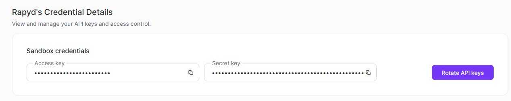
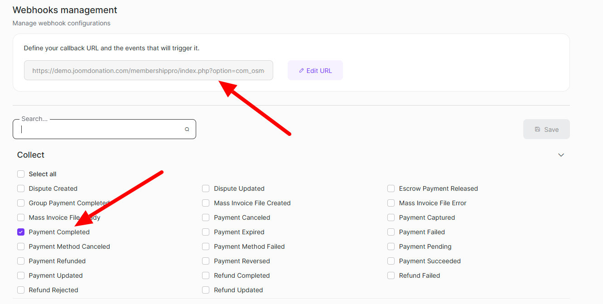

## Installation
When you purchase the payment plugin, you will receive a zip file called **os_osm_rapyd.zip**.

- Go to **Membership Pro** -> **Payment Plugins** to install the payment plugin **os_osm_rapyd.zip** as any other payment plugin. See [https://docs.joomdonation.com/membershippro/basic-setup/payment-plugins#install-new-payment-plugin](https://docs.joomdonation.com/membershippro/basic-setup/payment-plugins#install-new-payment-plugin) for installation instructions if needed.

## Configuration

1. Login to Rapyd dashboar, access to Developer menu from left sidebar [https://dashboard.rapyd.net/developers/api-control](https://dashboard.rapyd.net/developers/api-control). Get Access Key, Secret Key of your Rapyd account and enter it into payment plugin parameters.

2. Create webhook: From Developer menu, access to Webhooks and create webhook with this URL:

https://domain.com/index.php?option=com_osmembership&task=payment_confirm&payment_method=os_rapyd

Replace https://domain.com by URL of your site

Choose **Payment Completed** on the Collect section for the webhook

