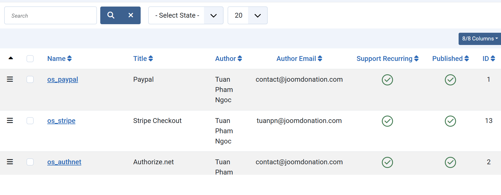
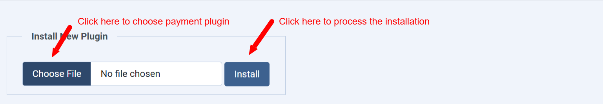

Subscribers must pay for a paid plan (price > 0) before their subscription becomes active.

In order to receiving online payment from your subscribers, you will need to configure Membership Pro to use the payment plugins you want. When you install Membership Pro, there are 4 payment plugins installed with it by default: **Paypal** (Paypal payment standard), **Authorize.net (AIM)**, **Eway** and **Offline Payment**.

To open Payment Plugins Management page, there are 3 different ways:
1. Access to **Components** -> **Membership Pro** -> **Payment Plugins**
2. Access to Membership Pro Dashboard, then click on **Payment Plugins** icon.
3. On any pages in Membership Pro, access to **Setup** -> **Payment Plugins** menu item.

>>>>> Right now, we only have 5 payment plugins support recurring payment feature. It is: Paypal, Paypal Pro, Authorize.net and Stripe, Mollie. All other payment plugins only support onetime payment

>>>>> When subscribers sign up for a recurring subscription plan, only recurring payment plugins are available for them to select. For example, even you publish **Eway** plugin, it will still not available on the subscription form of recurring subscription plan because **Eway** plugin doens't support recurring payment.

## Install New Payment Plugin

Sometimes, you will need to use a payment plugin which doesn't come with Membership Pro by default. In this case, you might have to purchase these payment plugins at [https://joomdonation.com/payment-plugins/membership-pro-payment-plugins.html](https://joomdonation.com/payment-plugins/membership-pro-payment-plugins.html)  (if it is available) or develop it yourself (or hire someone to develop it for you). Once you got the payment plugin, you will need to install it.  Please follow the step below to install a payment plugin:
1.  Go to **Membership Pro** -> **Payment Plugins**
2.  Scroll to bottom of the page.
3.  Click the **Choose File** button to browse for the payment plugin.
4.  Click the **Install** button to process the installation.

## Common Tasks

### Unpublish un-used payment plugins
It is very likely that you won't use all of the 4 payment plugins come with Membership Pro out of the box, so you will need to unpublish the one you don't want to use. There are two ways to unpublish a payment plugin:
1. Click on the green (published) icon in the Published column.
2. Check on the checkbox next to the payment plugin, then click the **Unpublish** button in the toolbar.

### Change title of payment plugin

You might want to change the title of the payment plugin to make it easier to understand to your end users. For example, you might want to change the title from **Authorize.net** to **Creditcard**....

To change title of the payment plugin, please click the payment plugin to edit, change the title to suit your needs, then press Save button on the toolbar to apply the change.

## Translate payment plugin title

If your site is a multilingual website and want the title of the payment plugin change depend on the language user uses in the frontend, you need to do some steps below:
1. Use a language item for title of the payment plugin. For example, change the title to OS_PAYPAL instead of Paypal
2. Go to **Membership Pro => Translation**, click the **New Item** button in the toolbar. Then enter a new language item for the payment method title. Press save
3. Translate the new language item which you just created.

### Using icons for payment methods
By default, Membership Pro displays title of payment methods on registration form. Starting with version 2.7.0, you can choose to display payment method icons instead.
Membership Pro has many payment method icons come with it by default. In case you use a payment methods which doesn't have icon available, get the icon (maybe from the payment gateway website), upload to **media/com_osmembership/assets/images/paymentmethods** folder to make it available for using. Below are list of icons available by default:
1. os_paypal.png
2. os_authnet.gif
3. os_eway.gif
4. os_stripe.png
5. beanstream-logo.jpg
6. os_braintree.jpg
7. os_ccavenue.gif
8. os_creditcard.gif
9. os_eselect.gif
10. os_express_checkout.png
11. os_firstdatae4.png
12. os_gocardless.png
13. os_moip.gif
14. os_offline.png
15. os_pagseguro.gif
16. os_payfast.png
17. os_paymill.png
18. os_paypal_pro.gif
19. os_paypoint.png
20. os_realex.jpg
21. os_saferpay.png

To show the icon of payment method, please click on the payment plugin to edit, select the icon you want to use for payment plugin. In case the payment plugin you are using doesn't have **Icon** parameter yet, please look at **components/com_osmembership/plugins** folder, find the xml file of that payment plugin (for example, os_ideal.xml, add the icon parameter like below to the XML file, then you will see the parameter available

<field name="icon" type="imagelist" directory="media/com_osmembership/assets/images/paymentmethods" label="Icon"
                       description="If you want to show icon instead of payment method title on the subscription form, upload it to media/com_osmembership/assets/images/paymentmethods folder and select the icon here" />

### Make a payment plugin selected by default

When the subscription form is being displayed, the first payment plugin will be selected by default. So if you want a payment plugin to be selected, you can change the ordering of the payment plugin so that it will be the first plugin on the list and it will be selected by default.
