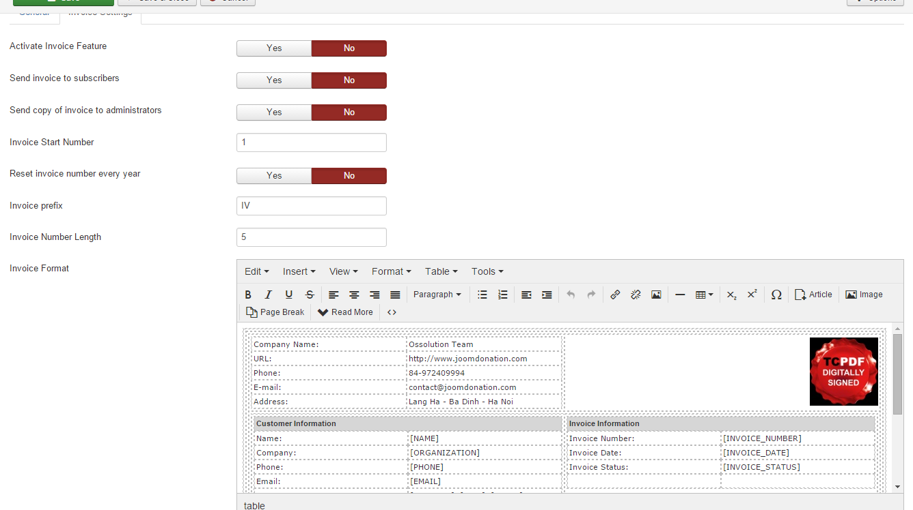

Membership Pro supports PDF invoice feature. If you enable this feature, when subscribers subscribe/ renew/ upgrade their membership, there will be an invoice PDF generated:
1. The layout of the invoice PDF is configurable
2. The invoice PDF will be generated for each transaction
2. The invoice PDF can be configured to send subscriber's email
3. A copy of the invoice can be configured to send to admin's email
4. Admin can download invoices for the subscriptions by accessing to Membership Pro => Subscriptions section.
5. If admin wants to download all invoices, he can downdown it via FTP. All generated invoices are stored in **media/com_osmembership/invoices** folder of the site
6. Subscriber can also download the invoices from Membership Profile page or Subscription History page in Membership Pro

Please look at [Invoice Settings](../../getting-started/configuration#invoice-settings) to see how to config and use this feature.

## Supported tags
Membership Pro generates default invoice layout when you first install the extension. However, in most case, you would want to change that invoice layout to meet your own need. Below are list of tags you can use to design the invoice:

### Plan Information
- [PLAN_TITLE]
- [PLAN_SHORT_DESCRIPTION]
- [PLAN_DESCRIPTION]
- [PLAN_ID]
- [PLAN_ALIAS]
- [PLAN_PRICE]
- [CATEGORY]

### Subscription Information
- [FIRST_NAME]
- [LAST_NAME]
- [NAME] (Combine of First Name + Last Name)
- [EMAIL]
- [USER_ID]
- [ORGANIZATION]
- [ADDRESS]
- [ADDRES2]
- [CITY]
- [STATE]
- [PHONE]
- [FAX]
- [COMMENT]
- Any custom fields using the syntax [NAME_OF_FIELD_IN_UPPERCASE], for example, if you have a custom field name registration_type, then the tag is [REGISTRATION_TYPE]
- [USER_ID]
- [MEMBERSHIP_ID]
- [PROFILE_ID]
- [FROM_DATE]
- [TO_DATE]
- [END_DATE] (same value with [TO_DATE])
- [CREATED_DATE]

## Payment Information Tags
- [SETUP_FEE]
- [ITEM_AMOUNT]  (the amount after discount, tax)
- [ITEM_SUB_TOTAL] (same as [ITEM_AMOUNT])
- [DISCOUNT_AMOUNT]
- [SUB_TOTAL] (ITEM_AMOUNT + SETUP_FEE - DISCOUNT_AMOUNT)
- [TAX_AMOUNT]
- [PAYMENT_PROCESSING_FEE] 
- [TOTAL_AMOUNT]  (The final payment amount users have to pay)
- [TAX_RATE]
- [PAYMENT_METHOD]
- [TRANSACTION_ID]

### Invoice information
- [ITEM_NAME] : Description of the payment
- [ITEM_QUANTITY] : Hardcoded to 1
- [INVOICE_NUMBER]
- [INVOICE_DATE]
- [INVOICE_STATUS]

