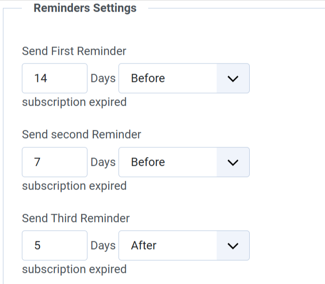
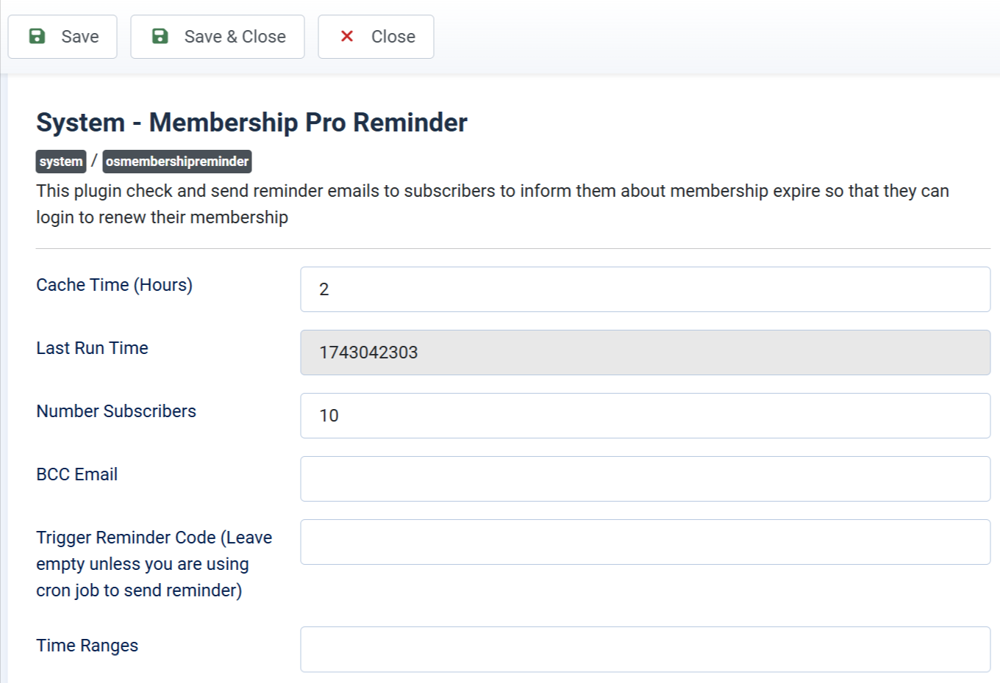
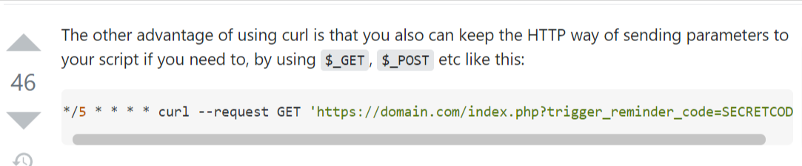

**Membership Pro** alllows you setup the system to send reminder emails to subscribers before/after their subscriptions expired so that they know about it and renew their subscriptions if they want.

## Configure subscription plans to allow sending reminder emails
**Membership Pro** allows you to send up to 3 reminder emails to subscribers before or after their subscription expired. When you add/edit a subscription plan, you will see three settings:

**Send First Reminder**

**Send Second Reminder**

**Send Third Reminder**

Enter the number you want for each setting (leave it empty or 0 to disable sending a reminder email), choose to send before/ after subscription expired, depends on your need.

## Configure reminder email messages
Membership Pro generate default reminder email messages when you first install the extension. However, it is good to review and change these default messages to meet your own need if needed. To do that, go to **Membership Pro -> Emails & Messages**, look at Reminder messages tab, change the following email subject & messages if you want:

*  **First Reminder Email Subject**
*  **First Reminder Email Body**
*  **Second Reminder Email Subject**
*  **Second Reminder Email Body**
*  **Third Reminder Email Subject**
*  **Third Reminder Email Body**

You can use the following tags in the email messages:
- [PLAN_TITLE]
- [FIRST_NAME]
- [LAST_NAME]
- [NUMBER_DAYS] (Number days before/after subscription expired)
- [MEMBERSHIP_ID]
- [EXPIRE_DATE] (The date which the current subscription expired)
- [PAYMENT_METHOD] 

If it is needed, you can even setup these reminder email messages for each subscription plan. If you do so, the messages which you setup in the plan will override (has higher priority than) the messages you setup in Membership Pro -> Emails & Messages section. Edit the plan, look at **Reminder Messages** and setup it if it is really needed.

## Publish and configure Membership Pro Reminder plugin

To have system send reminder email to subscribers, you need to go to Extensions -> Plugins, find and publish **System - Membership Pro Reminder** plugin. The plugin will be run every 2 hours (by default) to check and send reminder emails to subscribers. It has following parameters, you can review and change it to meet your own need if needed

- **Cache Time (Hours)**: Control how often the plugin will run to send reminder emails. By default, it's 2 hours
- **Number Subscribers**: How many subscribers the system should send reminder each time the plugin runs. You should not set it to a high value to avoid timeout during sending emails (or reach the mail limit your hosting allow to be sent each hour). Default value is 10, should be enough.
- **BCC Email**: You can enter an email here if you want to monitor the reminder email. Each time the system send reminder email to your subscribers, a copy of that email will be sent to the email you entered into that setting so that you can monitor it.

## Use Cron Job
By default, Membership Pro uses a system plugin to trigger sending reminder emails. That mean it requires someone access to the site (search engine bots are also counted) to trigger reminder process. Sometime, it is not reliable or causes multiple reminder emails sent to subscribers in case your site has a very high traffic. To address that limitation, you can setup cron job from your hosting account to trigger sending reminder instead. Please see detailed instructions below:

1. Go to Extensions -> Plugins, find that plugin Membership Pro Reminder , click on it to edit. You should see a  parameter called **Trigger Reminder Code** . Enter a secret string there

2. Setup a cron job to make a request to this URL using CURL (note that you should use the CURL so that the variable can be passed in the GET request, see [https://stackoverflow.com/questions/11375260/cron-command-to-run-url-address-every-5-minutes](https://stackoverflow.com/questions/11375260/cron-command-to-run-url-address-every-5-minutes) for detailed instructions

**https://domain.com/index.php?trigger_reminder_code=SECRETCODE**

- Replace **https://domain.com/** with URL of your site
- Replace **SECRETCODE** with the secret string which you entered in the Trigger Reminder Code parameter

That will make the reminder only processed when there is a request made to that URL (which should be secret as no real users will access to that URL). It will make it more reliable compare to replying a system plugin.

## Control the time reminder emails sent
By default, the reminder emails will be sent at a random time (it depends on when there are someone access to your site - even search engine bots- or when the cron job is triggered if you use cron job). That mean the reminder email could be sent at the midnight and you might not like it

If you want the reminder emails sent at a certain time in the day already (in the Time Zone configured in **Website Time Zone** config option in **System -> Global Configuration** of your site), you can use **Time Ranges** parameter inside the plugin. For example, set it to** 5,14** will make the system only send email reminder from **5am to 2pm**. Set it to **8,10;14:18** will allow sending  reminders between **8 to 10 am and 2pm to 6pm**.

## Log reminder emails
If you want, you can config the system to log reminder emails so that you can monitor it (when it is sent, what's the actual email subject and email message...). To do that, access to Membership Pro -> Configuration, look at Mails Settings section, set Log Emails config option to Yes.

Now, each time the system sends reminder email, a copy of that email will be logged in database. You can access to Tools -> Emails Logs to see these logged emails

