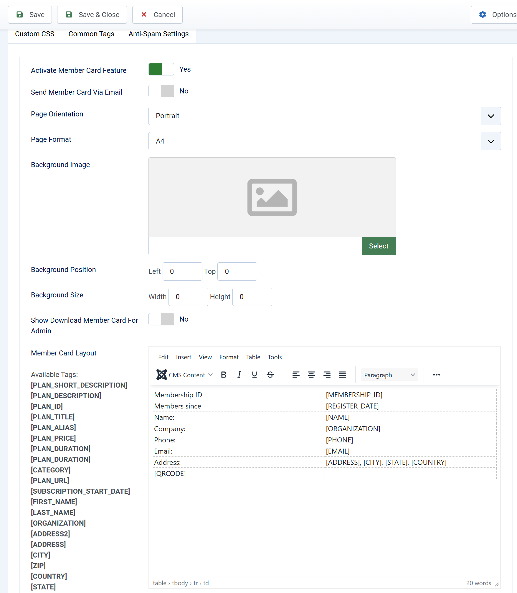
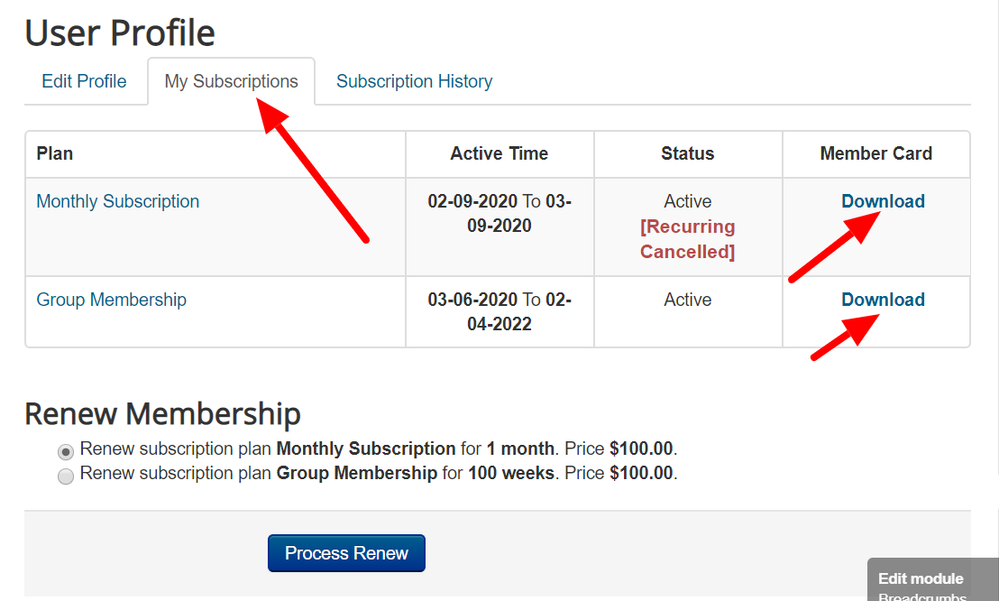

**Membership Pro** alllows you setup the system to allow subscribers to download PDF membership card from their user profile when they subscribe for any of your subscription plans which has Member Card enabled.

## Enable Member Card

First, you need to go to Membership Pro -> Configuration, look at **Member Card Settings** tab, set **Activate Member Card Feature** config option to Yes. 

Please note that Member Card feature needs to be enabled for each subscription plan, so if you created subscription plans before enabling this option, you need to edit the plan you want, look at **Member Card Settings** setting tab, set **Activate Member Card** parameter of that plan to **Yes**.

## Design Member Card
Membership Pro -> Configuration, look at **Member Card Settings** tab, look at **Member Card Layout** parameter and design the default Member Card layout for all of your plans. If you have a special plan which needs to use it's separate Member Card Layout, edit that plan, change **Member Card Layout** directly from that plan settings.

### Plan Information
- [PLAN_TITLE]
- [SHORT_DESCRIPTION]
- [DESCRIPTION]

### Member Information
- [FIRST_NAME]
- [LAST_NAME]
- [NAME] (Combine of First Name + Last Name)
- [EMAIL]
- [USER_ID]
- [ORGANIZATION]
- [ADDRESS]
- [ADDRES2]
- [CITY]
- [STATE]
- [PHONE]
- [FAX]
- [COMMENT]
- Any custom fields using the syntax [NAME_OF_FIELD_IN_UPPERCASE], for example, if you have a custom field name registration_type, then the tag is [REGISTRATION_TYPE]
- [MEMBERSHIP_ID]
- [PROFILE_ID]
- [CREATED_DATE]
- [INVOICE_NUMBER]
- [PLAN_SUBSCRIPTION_START_DATE]
- [PLAN_SUBSCRIPTION_TO_DATE]

## Subscriptions Information
- [SUBSCRIPTIONS] (This tag will show list of subscriptions of the member)

## How Subscribers can download member card
If you enable this feature, when subscriber login and access to User Profile [http://docs.joomdonation.com/membershippro/frontend-items/user-profile](/frontend-items/user-profile), he will see a Download Member Card link which allow clicking on to Download Member Card

## Use [QRCODE] To Check Membership Status

If you want to check membership status of your member, you can insert [QRCODE] tag in the member card layout and use built-in QR CODE Scanner to check membership status. See [QRCODE Scanner](/frontend-items/qrcode-scanner) for detailed instructions.