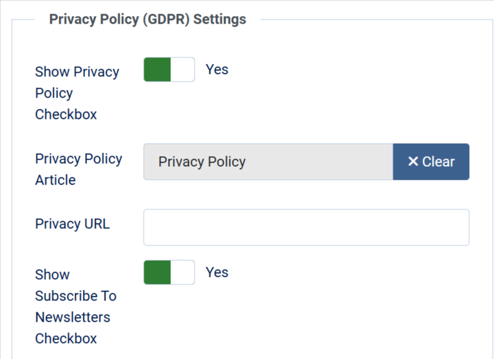
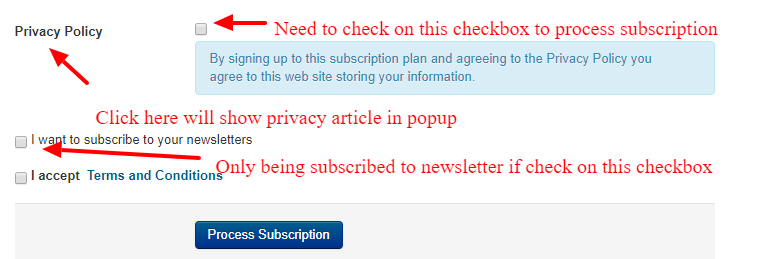

[GDPR](https://en.wikipedia.org/wiki/General_Data_Protection_Regulation) is now supported in Membership Pro (from version 2.13.2). If you run a website require compatible with this rule, You can go to Membership Pro -> Configuration, look at **Privacy Policy (GDPR) Settings** section, change the necessary settings to have the extension compatible with that requirement:

1. **Show Privacy Policy Checkbox**: Set to Yes
2. You can create a Privacy Policy Article and select that article for **Privacy Policy Article** setting
3. If you use ACYMailing or Mailchimp plugin to subscribe registrants to your newsletter, you need to set **Show subscribe to newsletters checkbox** config option to Yes

With that setup:

1. Registrants will have to check on **Privacy Policy** checkbox to process the registration. They can also click on **Privacy Policy** to see the privacy policy article.
2. The default privacy short text is **By signing up to this subscription plan and agreeing to the Privacy Policy you agree to this web site storing your information.**. If you want to change it, you can go to Membership Pro -> Translation, find the language item OSM_AGREE_PRIVACY_POLICY_MESSAGE and change it.
3. Users will only be subscribed to your newsleters if they check on **I want to subscribe to your newsletters** checkbox.

You might also want to Membership Pro -> Configuration, set **Delete user's subscription when account deleted** config option to Yes so that when user account is deleted (by admin or by user himself), all subscriptions record related to that account will be deleted. Please be careful with using this option as the data will be deleted permanent, so only used if it's really needed.