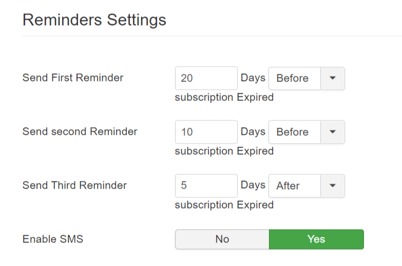
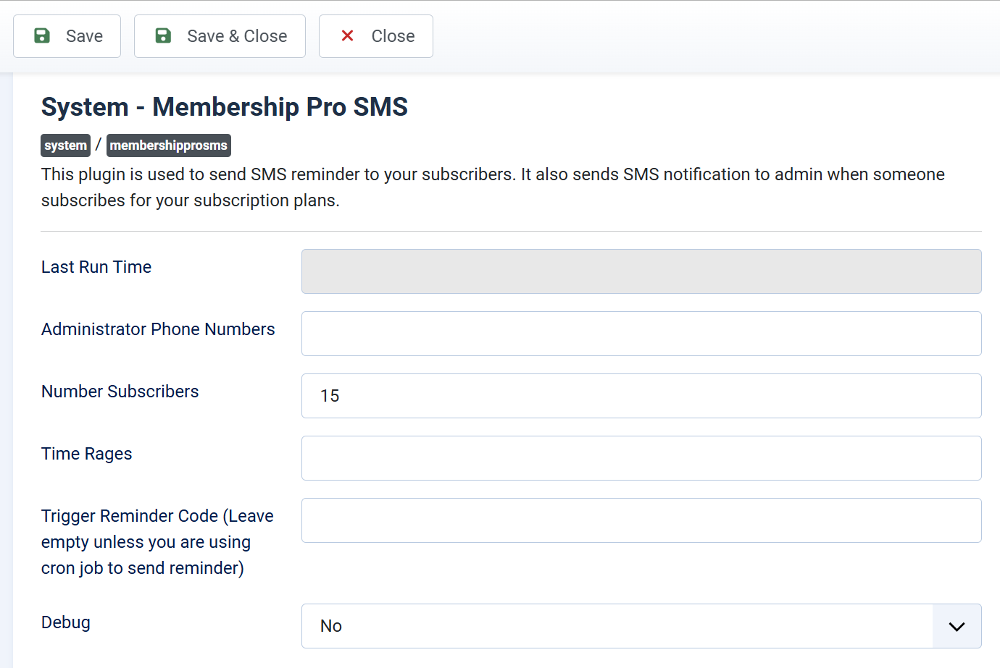

**Membership Pro** alllows you to to send **SMS Reminders** emails to subscribers before/after their subscriptions expired so that they know about it and renew their subscriptions if they want. It also allows sending SMS message to notify administrators when there is someone subscribes for a plan on your website. To use this feature:

## Configure plans to allow sending SMS Reminders
Membership Pro allows you to send up to 3 SMS reminder to subscribers before or after their subscription expires. When you add/edit a subscription plan, you will see three settings.

**Send First Reminder**
**Send Second Reminder**
**Send Third Reminder**

Enter the number you want for each setting (leave it empty or 0 to disable sending SMS reminder), choose to send before/ after subscription expires, depends on your need. Also, you need to set **Enable SMS** setting to Yes to have the system send SMS messages for this plan.

## Configure SMS Reminder Messages
Membership Pro generate default sms reminder messages when you first install the extension. However, it is good to review and change these default messages to meet your own need if needed. To do that, go to Membership Pro -> Emails & Messages, look at **SMS Messages** tab, change the following items to suit your needs:

*  **New Subscription SMS**
*  **New Subscription Renewal SMS**
*  **New Subscription Upgrade SMS**
*  **First Reminder SMS**
*  **Second Reminder SMS**
*  **Third Reminder SMS**

You can use the following tags in the email messages:
- [PLAN_ID]
- [PLAN_TITLE]
- [ID]
- [FIRST_NAME]
- [LAST_NAME]
- [ORGANIZATION]
- [ADDRESS]
- [ADDRESS2]
- [CITY]
- [STATE]
- [COUNTRY]
- [PHONE]
- [FAX]
- [EMAIL]
- [COMMENT]
- [FROM_DATE]
- [TO_DATE]
- [CREATED_DATE]
- [END_DATE]
- [EXPIRE_DATE]
- [FROM_PLAN_TITLE] (only available for New Subscription Upgrade SMS message)

## Publish and configure System - Membership Pro SMS plugin

To have system send sms reminders to subscribers, you need to go to Extensions -> Plugins, find and publish **System - Membership Pro SMS** plugin. The plugin will be run every 20 minutes to check and send sms reminder to subscribers. It has follows parameters, you can review and change it to meet your own need if needed

- **Administrator Phone Numbers**: Enter administrator phone numbers which you want to receive SMS notification when someone signs up for your plans. Multiple phone numbers are supported, just separate these numbers by comma.
- **Number Subscribers**: How many subscribers the system should send reminder each time the plugin runs. You should not set it to a high value to avoid timeout during sending sms messages. Default value is 15, should be enough.
- **Time  Ranges**: By default, the system will check and send SMS reminder to subscribers every 20 minutes, that means subscribers will receive SMS reminders at random time in the day (could be midnight). To prevent that, you can set up the time ranges you want to send reminder emails.

## Publish And Configure SMS Plugin
To be able to send SMS reminder, you need to use a SMS gateway. Currently, Membership Pro supports follow SMS gateways:

- Clickatel [https://www.clickatell.com/](https://www.clickatell.com/)
- Clockwork [https://www.clockworksms.com/](https://www.clockworksms.com/)
- Textlocal [https://www.textlocal.com/](https://www.textlocal.com/)
- Nexmo (now Vonage) [https://www.vonage.com/](https://www.vonage.com/)
- Twilio [https://www.twilio.com//](https://www.twilio.com/)

Depends on the SMS gateway you are using, you need to enable and configure the related SMS Plugin (go to Extensions -> Plugins, find the plugin, enter necessary paramerers and enable it):

- **Membership Pro SMS - Clickatell**
- **Membership Pro SMS - Clockwork**
- **Membership Pro SMS - Nexmo**
- **Membership Pro SMS - Textlocal**
- **Membership Pro SMS - Twilio**

Due to the size of the SMS plugin, two plguins **Membership Pro SMS - Nexmo** and **Membership Pro SMS - Twilio** are not shipped in Membership Pro package. You can download these plugins and install it manually from the links below case you want to use it

[plug_membershiprosms_nexmo.zip](plug_membershiprosms_nexmo.zip)

[plug_membershiprosms_twilio.zip](plug_membershiprosms_twilio.zip)

## Use Cronjob To Send SMS Reminders
By default, Events Booking uses a system plugin to trigger sending reminder emails. It's easy to setup (just need to publish the **System - Membership Pro SMS** plugin), however, it also has some downside:

- It requires there is someone access your site to trigger sending reminder process.
- The time reminder is sent is random (depends on the time someone access your site). If you only want the reminders be sent at midnight everyday, it won't be possible.

If you want to address these limitation, you can setup cronjob (For example, you want the system to send reminder at 3pm every day), you can set up cron job:

1. Go to Extensions -> Plugins, find the plugin **System - Membership Pro SMS**, click on it to edit
2. Find the parameter **Trigger Reminder Code**, set it to a secret string you want, for example **runsmsreminder**.
3. Setup a cron job to make a request to this url https://domain.com/index.php?trigger_reminder_code=runsmsreminder (of course https://domain.com/ needs to be replaced with url of your site and **runsmsreminder** will need to be the sam with the string you entered in Trigger Reminder Code parameter in the plugin.

By that setup, your server will run the cron job, trigger sending reminder process at pre-determined time in the day (depends on your cron job setup).
