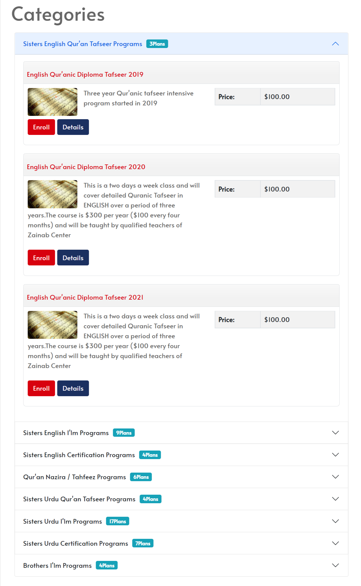

The Categories page displays categories and their plans in an accordion. Users can expand a category to see its plans and sign up.

To use this layout, you need to create a menu item to link to **Categories Accordion** menu option of **Membership Pro**. Beside common Joomla menu items parameters, this menu option supports the following parameters specific to Membership Pro:

- **Parent Category**: If you choose a category in this parameter, the system will display all children categories of that selected category, otherwise, top level categories will be displayed.

