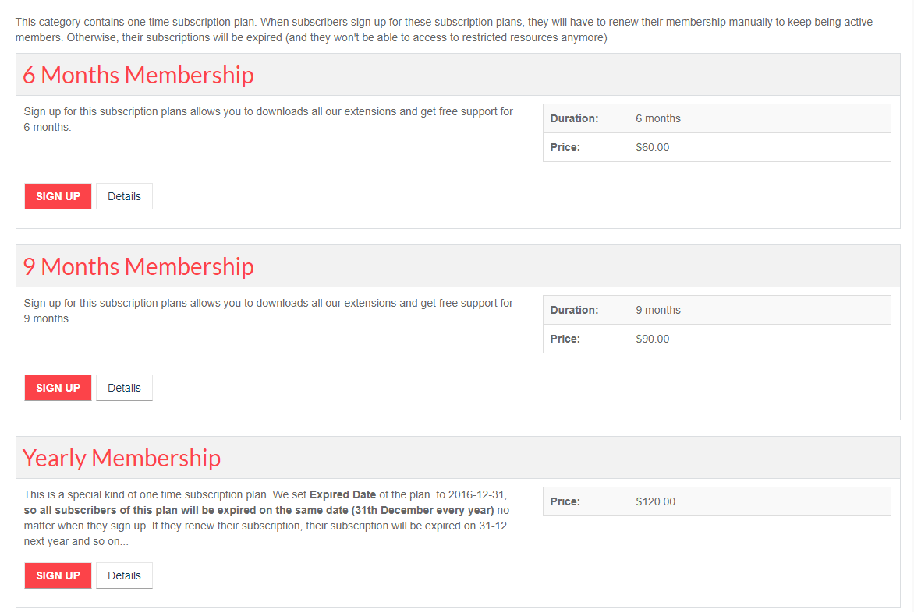
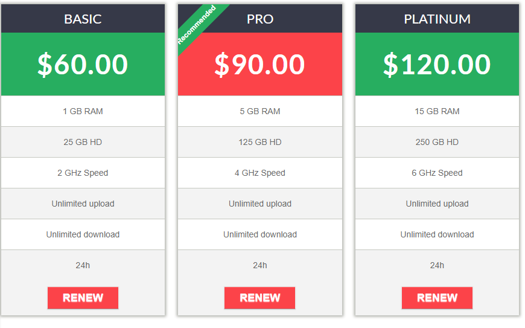
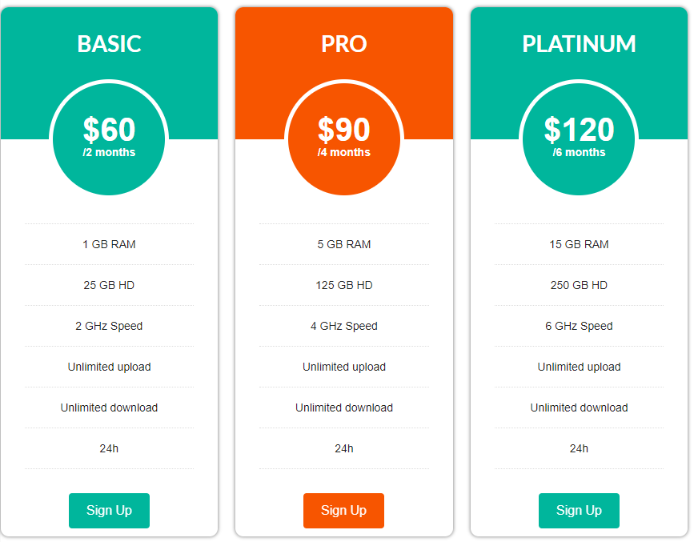
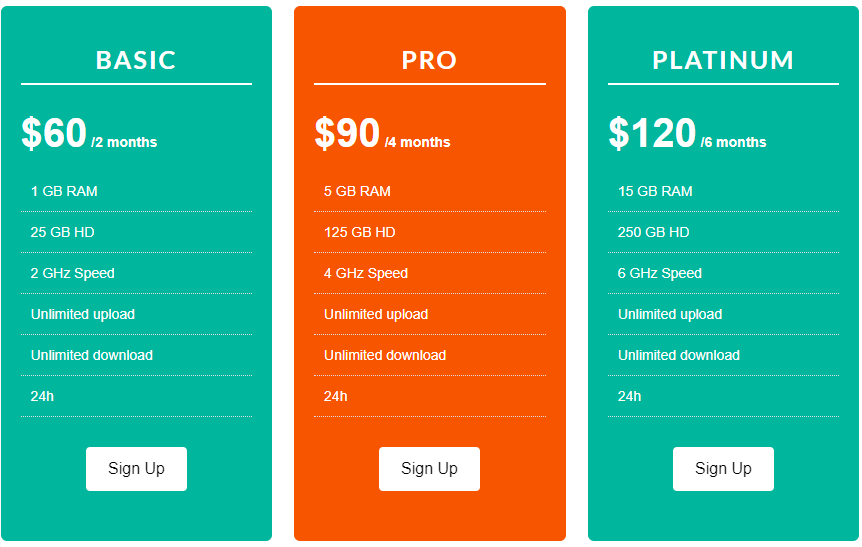
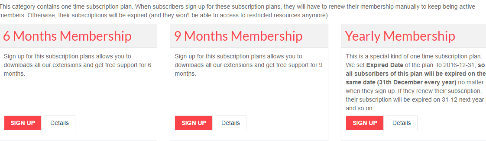

The **Plans** page lists the subscription plans you set up in Membership Pro, either from a single category or from all categories. Users can browse the plans, select a plan to see its details, or click **Sign Up** to subscribe. You can choose from **5 menu options** to display subscription plans.

## Plans List Default Layout


To use this layout, you need to ceate a menu item to link to **Plans List Default Layout** menu option of **Membership Pro**.

## Pricing Table Layout


To use this layout, you need to ceate a menu item to link to **Pricing table layout** menu option of **Membership Pro**. To have the plan displayed in the same style with the style in our demo site, you will need to edit the plan, enter the following HTML code structure into Short Description setting of the plan:

```html
<ul>
<li class="plan-feature">1 GB RAM</li>
<li class="plan-feature">25 GB HD</li>
<li class="plan-feature">2 GHz Speed</li>
<li class="plan-feature">Unlimited upload</li>
<li class="plan-feature">Unlimited download</li>
<li class="plan-feature">24h</li>
</ul>
```

## Pricing table circle layout


To use this layout, you need to ceate a menu item to link to **Pricing table circle layout** menu option of **Memership Pro**. 

## Pricing table flat layout

To use this layout, you need to ceate a menu item to link to **Pricing table flat layout** menu option of **Membership Pro**. 

## Plans List Column Layout


To use this layout, you need to ceate a menu item to link to **Pricing table flat layout** menu option of **Membership Pro**. 

## Menu parameters
All the menu options to display upcoming events have same set of parameters. Beside common Joomla menu items parameters, these menu options support the following parameters specific to Membership Pro:

- **Select Category**: If you choose a category in this parameter, the system will display subscription plans of that selected category, otherwise, subscription plans from all categories will be displayed