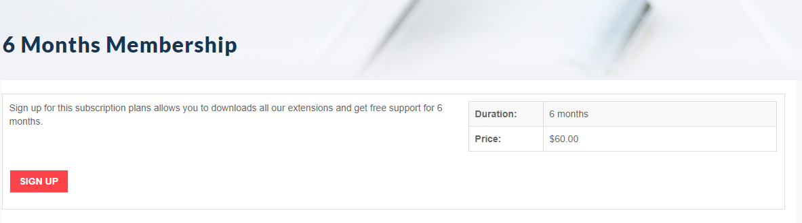

The **Plan Details** page shows a plan's subscription length, pricing, description, and other details. Users can open it from the plans list or a menu item and click Sign Up to subscribe.

To use this layout, you can create a menu item to link to **Plan Detail** menu option of **Membership Pro**. Beside common Joomla menu items parameters, these menu options support the following parameters specific to Membership Pro:

- **Select Plan**: Choose the plan you want to display when users click on this menu item. You need to choose a valid/publish plan for this parameter