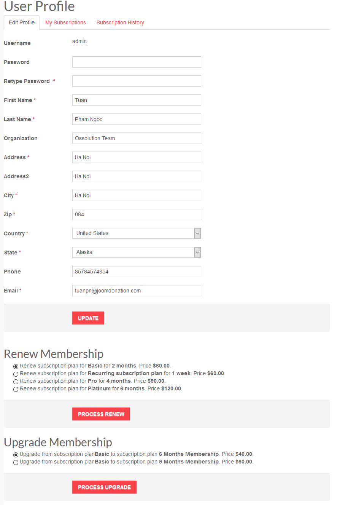

## User Profile

You can setup a menu item to link to **User Profile** view of **Membership Pro** to allow subscribers to access to his profile so that:
1. He can update his profile information (including account username / password). When he updates his profile data, these profile data will be syncronized to all of his subscription records.
2. He can see his subscription history (all subscription records), his subscriptions (list of plans which he subscribed, and when it will be expired..)
3. He can renew his membership (if there are renew options available)
4. He can upgrade his membership (if there are upgrade options available)
5. **He can cancel recurring subscription**: To cancel recurring subscription, he need to access to My Subscriptions tab, click on **Cancel subscription** button nex to the subscription he want to cancel to get it cancelled. Please note that, a recurring subscription can only be cancelled from user profile page if he signed up using one of the below payment plugins: **Paypal Pro, Authorize.net, Stripe, Mollie**. If he signs up for the plan using a different payment method, the  **Cancel subscription** won't be available (because the other payment gateways doesn't have API to allow us to call to cancel the subscription from within the site)

To use this feature, you need to ceate a menu item to link to **User Profile** menu option of **Membership Pro**. Before common Joomla menu items parameters, this menu option supports the following parameters specific to Events Booking:

1. **Show my subscriptions tab**: Default value is **Yes**. If you set it to No, the **My Subscriptions** tab will be hided.
2. **Show subscriptions history**: Default value is **Yes**. If you set it to No, the **Subscriptions History** tab will be hided.
3. **Show renew membership options**: Default value is **Yes**. If you set it to No, the **Renew Membership** section will be hided. You should only set it to No if you create a separate menu item to allow renewing membership.
4. **Show upgrade membership options**: Default value is **Yes**. If you set it to No, the **Upgrade Membership** section will be hided. You should only set it to No if you create a separate menu item to allow upgrading membership.

