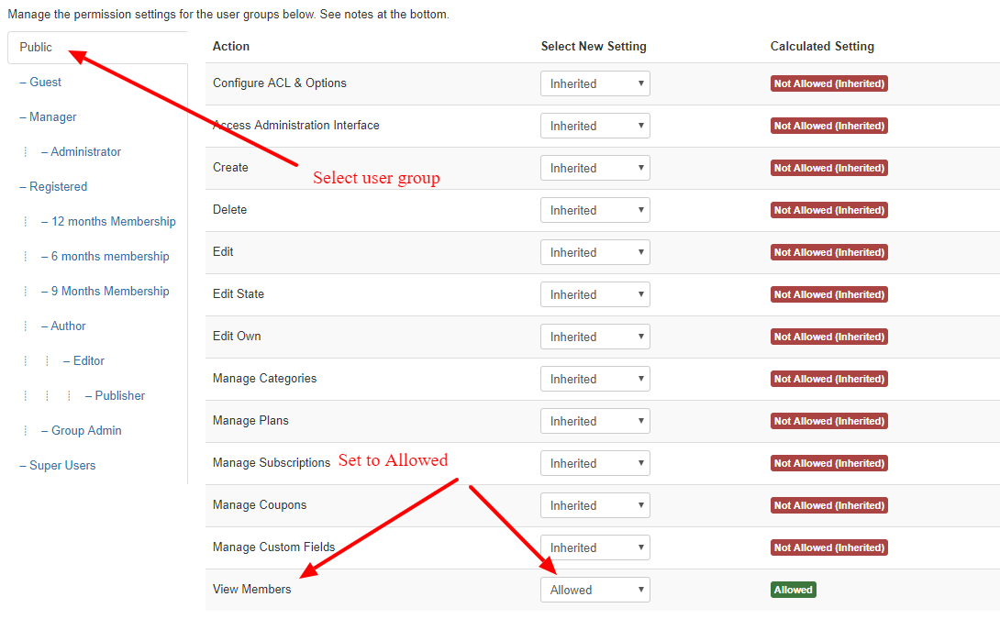
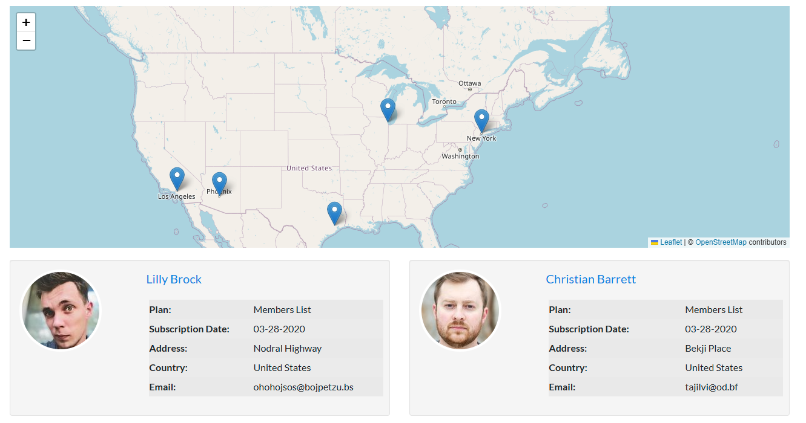
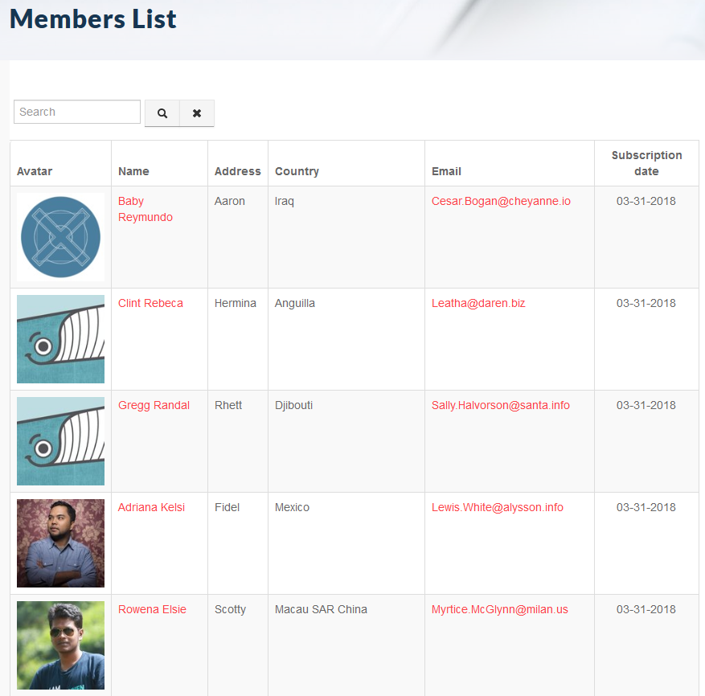

**Membership Pro** allows you to display subscribers from one or all subscription plans in the frontend of your site. You can control what Joomla user groups can see these subscribers and what fields will be showed on the subscribers list screen. Below are the steps to setup:
## Permission Configuration
Go to **Membership Pro -> Configuration** (or any pages in Membership Pro page in administrator area), click on **Options** button in the toolbar, select the user group(s) you want to allow viewing members list (for example, **Public** user group), set **View Members** permission to **Allowed**. Please note that permission settings in Joomla are inherited, so when you enable this permission for a user group (**Public** in this example), all it's children groups (Registered, Editor, Publisher.... in this example) will have this permission allowed, too.

## Create menu item
Next, you need to create menu item to link to one of the menu options below in Membership Pro:
* **Members List**
* **Members List Columns Layout**

Users belong to user groups have permission **View Members** set to Allowed can access to that menu item to see the members from one selected plan (or all plans). The menu items have the following parameters:
* **Select Plan**:  If you choose a subscription plan here, only subscribers of that selected plan will be displayed. If no plan is selected, subscribers from all plans will be displayed.
* **Show link to member detail page** : If set to Yes, users can click on the name of displayed members to see details information of that member.
* **Show Membership ID**: If set to Yes, Membership ID of members will be displayed.
* **Show Profile Avatar**: Set to Yes to show user avatar on this page (only set to Yes if you allow users to upload avatar - controlled in Configuration of Membership Pro)
* **Show Plan Column**: Set to Yes to show subscription plan of members.
* **Show Subscription Date Column**: Set to Yes to show the date which members subscribed for your plan
* **Show Subscription End Date**: Set to Yes to show subscription end date (expired date) of members
* **Subscription Status**: Default value is All. You select a subscription status (Pending/Active/Expired) in this parameter and the system will only display members with that status
* **Sort By**: Choose the column (First Name, Last Name....) which you want to sort members on that page
* **Sort Direction**: Choose sort direction (ASC/DESC)
## Control what information is displayed on registrants list
By default, Membership Pro only displays the following custom fields on members list page: **First Name, Last Name, Email, Organization**. If you want to display additional fields, please go to **Membership Pro -> Custom Fields**, edit the custom field, set **Show On Members List** property to **Yes**

## Display Members On Map
From version 4.8.0, Membership Pro allows displaying members on a map (above members list). If you want to have this option (check demo site at [https://demo.joomdonation.com/membershippro/member-area/members-list-columns](https://demo.joomdonation.com/membershippro/member-area/members-list-columns) ), please do the following steps:

- Set **Show Map** parameter of the menu item to **Yes**.
- Find the plugin **System - Membership Pro**, set **Calculate Coordinates** parameter to **Yes** so that coordinates for new subscriptions will be calculated automatically each time subscription record is created. It will also be re-calculated each time the subscription record is updated.
- If you have existing subscription records, the coordinates for these subscriptions are empty. So you need to create and enable **[Calculate Subscribers Coordinates](/scheduled-tasks/calculate-subscribers-coordinates)** scheduled task to calculate and update coordinates for these existing subscriptions so that it can be displayed on map

