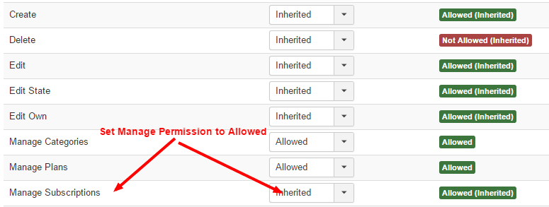
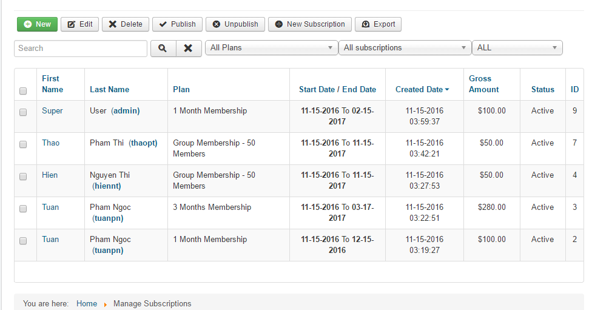

Membership Pro lets authorized users manage subscriptions from the frontend. As in the backend, they can view, create, renew, delete, and export subscription records or change their status.

To allow managing susbcriptions from frontend:

1. Go to **Membership Pro => Configuration**, click on Options button in the toolbar, select the user group you want to allow manage subscriptions, set **Manage Subscriptions** permission to **Allowed** 
2. Create a menu item to link to **Subscriptions Management** menu option of Membership Pro, you should set access level of this menu option depends on the user group you enable manage permission above (for example, set it to Special)

With that setup, the user can login, access to the menu item above to Manage Subscriptions

