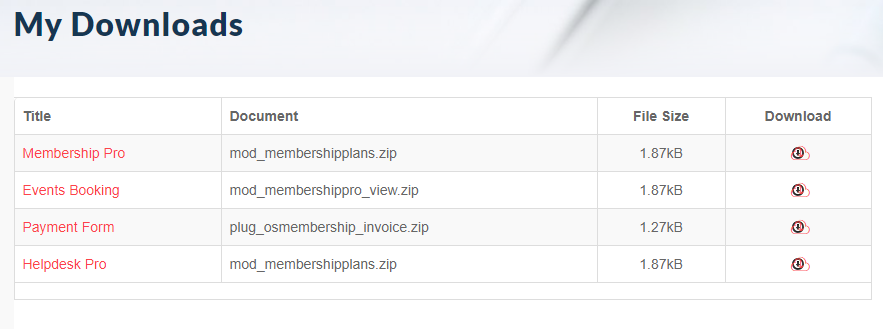
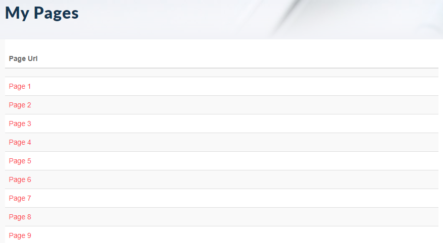
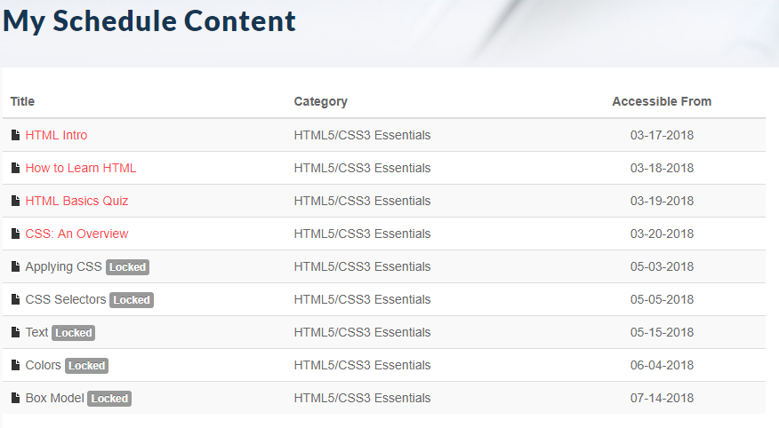
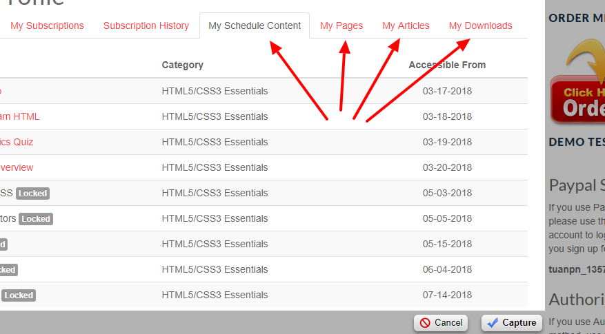

Membership Pro allows you to give subscribers access to restricted resources when they subscribe for your subscription plans. There are different menu options can be used to display list of each of these resources to allow subscribers to access to

## User's Documents

If you use [Downloads Manager Plugin](/advanced-features/downloads-manager-plugin) to restrict access to documents for subscribers, you can create a menu item to link to **User's Documents** menu option of **Membership Pro**. Subscribers can then access to this menu item to see list of documents which they can access and download the documents they want.

## My Pages

If you use [this method](/resources-access-restriction#restrict-access-to-any-pages-urls) to restrict access to certain pages on your site for subscribers, you can create a menu item to link to **My Pages** menu option of **Membership Pro**. Subscribers can then access to this menu item to see list of pages which they can access and access the page they want.

## User's Schedule Content
You can create a menu item to link to **User's Schedule Content** menu option of **Membership Pro** to allow subscribers to access to these Schedule Content (Joomla articles) setup by administrator for each subscription plan

## User's Schedule K2 Items
You can create a menu item to link to **User's Schedule K2 Items** menu option of **Membership Pro** to allow subscribers to access to these Schedule Content (K2 items) setup by administrator for each subscription plan

## Access to restricted resources from User Profile
Beside giving subscribers access to restricted resources via menu items, you can also give them access to restricted resources when they access to User Profile

1. If you restrict access to Joomla Articles, you can go to Extensions -> Plugins, find the plugin **Membership Pro Articles Restriction**, set **Display Articles in Profile** parameter to **Yes**. Subscribers now will see a tab called **My Articles** on profile page which display list of restricted articles which they can access and access to the articles they want.
2. If you restrict access to Joomla Pages/Urls, you can go to Extensions -> Plugins, find the plugin **Membership Pro URLs Restriction**, set **Display Urls in Profile** parameter to **Yes**. Subscribers now will see a tab called **My Pages** on profile page which display list of restricted pages/urls which they can access and access to the page they want.
3. If you restrict access to documents,  Subscribers now will see a tab called **My Downloads** on profile page which display list of restricted documents which they can access and download the document they want.
4. If you use **Schedule Content** feature, Subscribers now will see a tab called **My Schedule Content** on profile page which display list of schedule artilces which they can access and access to the artile they want

