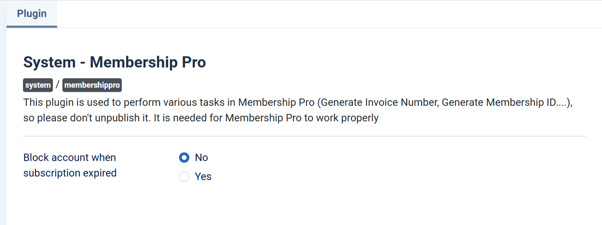

This plugin handles common tasks in Membership Pro.

1. Generate Invoice Number (if invoice feature is enabled)
2. Generate Membership ID (if you enable this option)
3. Create user account for subscriber and send activation email when subscription active (if you set **Only create user account when membership active/approved** config option to **Yes**)

This plugin is published automatically by Membership Pro install script when you install Membership Pro, please **DO NOT UNINSTALL OR UNPUBLISH IT**

If you ever want to block subscriber's user account when their subscription expires, you can set the parameter **Block account when subscription expired** of this plugin to **Yes**. I would suggest you to think carefully before enabling this parameter because if you do so, subscribers won't be able to log in to renew their membership after their subscription expires, so you will end up with loosing money.

