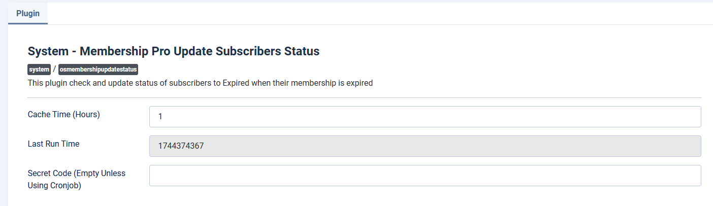
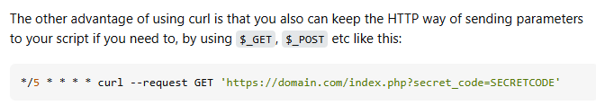

This plugin is run periodically every 2 hours to update status of the subscription records from **Active** to **Expired** when current datetime is greater than **Subscription End Date** of the subscription. It is enabled automatically by Membership Pro during installation process. Go to **System** -> **Plugins**,  find the publish **System - Membership Pro Update Subscribers Status**, click on it to edit, review and change the following parameters:

- **Cache Time (Hours)**: Control how often the plugin will run to send reminder emails. By default, it's 1 hour.

## Use Cron Job
By default, Membership Pro uses a system plugin to trigger update subscriptions status. That mean it requires someone access to the site (search engine bots are also counted) to trigger the process. Sometime, it is not reliable because there will be delay to update status of there is no-one access to the site during that time. To address that limitation, you can setup cron job from your hosting account to trigger update status process if needed. Please see detailed instructions below:

1. Go to System -> Plugins, find the plugin **System - Membership Pro Update Subscribers Status**, click on it to edit. You should see a  parameter called **Secret Code** . Enter a secret string there

2. Setup a cron job to make a request to this URL using CURL (note that you should use the CURL so that the variable can be passed in the GET request, see [https://stackoverflow.com/questions/11375260/cron-command-to-run-url-address-every-5-minutes](https://stackoverflow.com/questions/11375260/cron-command-to-run-url-address-every-5-minutes) for detailed instructions

**https://domain.com/index.php?secret_code=SECRETCODE**

- Replace **https://domain.com/** with URL of your site.
- Replace **SECRETCODE** with the secret string which you entered in the **Secret Code** parameter.

That will make the update subscription status process only triggered when there is a request made to that URL (which should be secret as no real users will access to that URL). It will make it more reliable compare to replying a system plugin.

