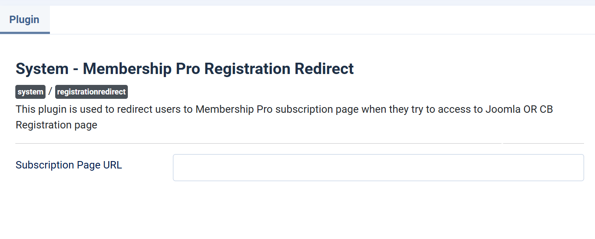

This plugin redirects users to the Membership Pro subscription page when they try to create an account through Joomla, Community Builder, or Jomsocial. Enable it if you want all site registration to go through Membership Pro.

To use this plugin, please follow the steps below:

1. Go to **System** -> **Plugins**, find and enable the plugin **System - Membership Pro Registration Redirect**.
2. The plugin has parameter called **Subscription Page URL**, you should enter URL which users can access to start the subscription process. If you leave this parameter blank, the plugin will auto detect the URL.

