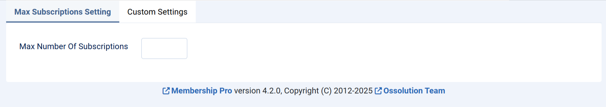

This plugin allows you to limit number of subscriptions which a subscription plan can accept. For example, if you have a subscription plan which only want to except 50 subscriptions, you can use this plugin. After number of the subscriptions for the plan reach the limit, the plan will be unpublished automatically by the system and users won't be able to subscribe for that plugin anymore

To use that plugin:

1. Go to **System** -> **Plugins**, find and enable the plugin **Membership Pro - Limit Subscriptions**
2. Now when you add/edit a subscription plan, you will see a new tab called **Max Subscriptions Setting**, just enter the number you want into **Max Number of Subscriptions** parameter (for example 50) and the system will only except that maximum number of subscriptions for the plan 

