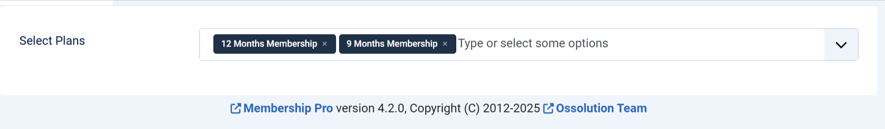

Use this plugin to subscribe users automatically to selected plans when they sign up for a specific plan.

To use this plugin, go to **System** -> **Plugins**, find and enable **Membership Pro - Auto Subscribe** plugin. Then edit the subscription plan, look at **Auto Subscribe** tab, select the subscription plans you want into **Select Plans** parameter

After that, when users sign up for the main subscription plan, they will be subscribed automatically for these  selected plans.

