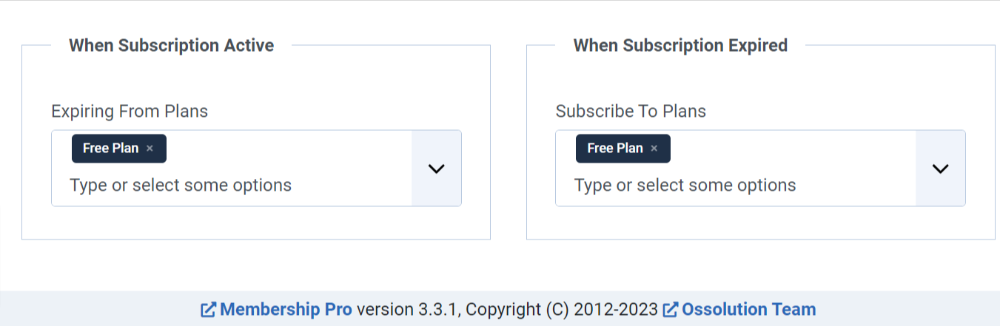

This plugin allows expiring subscription of users from certain plans when subscription for current plan active and subscribe for certain plans when subscription for current plan expired.

To use this plugin, go to **System** -> **Plugins**, find and enable **Membership Pro - Subscription Control** plugin. Then edit the subscription plan, look at **Subscription Control Settings** tab, make necessary settings to get it works as you want.

