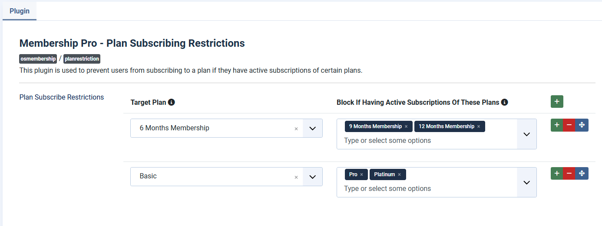

This plugin allows preventing users subscribe to a subscription plan if they have active subscription of other selected plans

To use this plugin, go to **System** -> **Plugins**, find and enable **Membership Pro - Plan Subscribing Restrictions** plugin. Click on it to edit, setup the parameter to have the restrictions you want:

- **Target Plan**: Select the plan which you don't want users to subscribe if they have active subscription of the other plans
- **Block If Having Active Subscriptions Of These Plans**: Select the plans which if users have active subscriptions of these plans, they won't be allowed to subscribe for the plan selected in **Target Plan** column

For example, with the setup in the screenshot, if someone has active subscription of **9 Months Membership** or **12 Months Membership**, he won't be allowed to subscribe to **6 Months Membership** plan.

