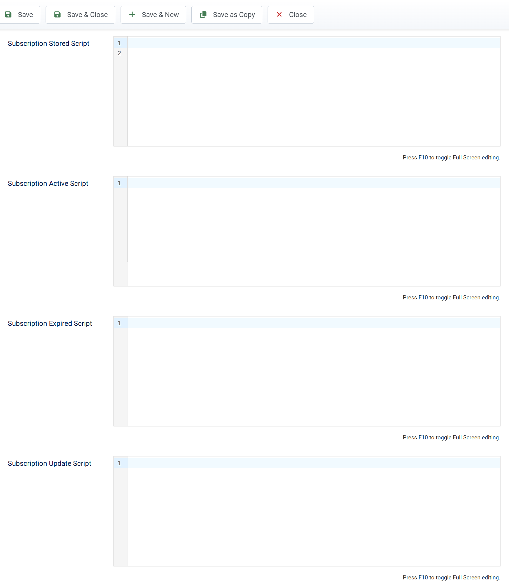

If you want to execute **PHP code** when a subscription is being created, become active (when payment complete), become expired or become updated, you can use **Membership Pro - PHP Script** plugin

1. Go to **System** -> **Plugins**, find and enable the plugin **Membership Pro - PHP Script**
2. Now, when you add/edit a subscription plan, you will see a new tab called **PHP Script Settings**. You can enter the PHP code you want to run:

* After subscription record is stored in to the database. Enter that PHP code into **Subscription Stored Script** parameter
* After subscription record become active. Enter that PHP code into **Subscription Active Script** parameter
* After subscription record become expired. Enter that PHP code into **Subscription Expired Script** parameter
* After subscription record is updated. Enter that PHP code into **Subscription Update Script** parameter

Some notes:
1. You don't have to use **<?php** and **?>** tag to open and close the PHP code
2. In the PHP script, you can use a variable called $row. It contains all information of the subscription record. For example $row->first_name, $row->last_name, $row->email, $row->plan_id....
3. You can use any Joomla code, Membership Pro library code in these script (these script is executed inside in Joomla envirentment, so you can use all libraries provided by Joomla and Membership Pro here)

