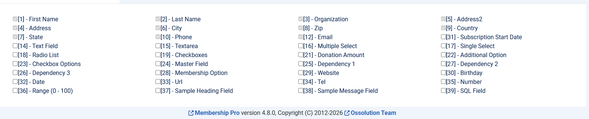

Normally, you will select the plans which you want to assign custom field to when directly on custom field add/edit screen. That mean when you create a new plan and want to assign custom field to that plan, you will need to edit the custom field and select the new plan. That might be inconvenience, and and this **Membership Pro - Fields Assignment** can help. It allows you to select the custom fields which you want to be available on subscription form of that plan directly on a tab on add/edit plan screen.

1. Go to **System** -> **Plugins**, find and enable the plugin **Membership Pro - Fields Assignment**
2. Now when you add/edit a subscription plan, you will see a new tab called **Fields Assignment** allows you to select custom fields which you want to be available for that plan. Please note that for fields which has **Field Assignment** set to **All Plans** won't be selectable (the checkbox next to that field is disabled) because the field will be available for all plans, mean it will be available for the plan currently being edited. So if you want to allow a field to be selectable on add/edit plan screen, please set **Field Assignment** to **All Selected Plans**

