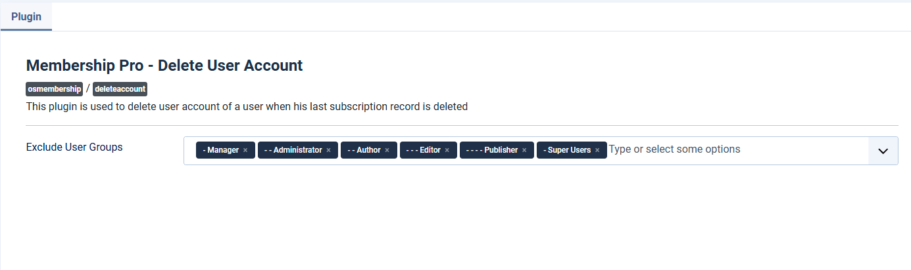

Enable **Membership Pro - Delete User Account** under System -> Plugins to delete a subscriber's Joomla account when all of their Membership Pro subscription records are removed. Use **Exclude User Groups** to keep accounts that belong to the selected groups.

By default, the plugin excludes groups such as Super Users, Administrator, Editor, and Publisher. Adjust the selection to suit your needs.

