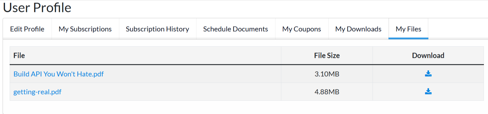

This plugin gives administrator a simple way to upload files for individual user and that user can download these files from his user profile. To use this feature:

- Find and enable **Membership Pro - User Files** plugin. 

- Upload files for the user you want (via FTP for example) to **media/com_osmembership/userfiles/[username]** or **media/com_osmembership/userfiles/[userid]** folder. Replace [username] and [userid] in the path above with the username and User ID of the user you want.

