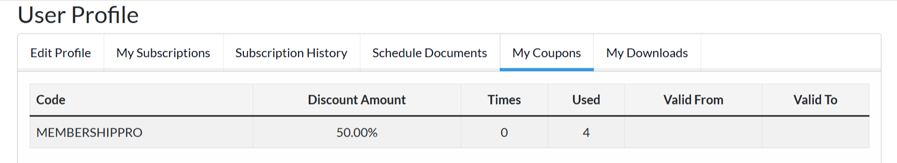

This plugin can be used to display coupon codes assigned to the current user in his User Profile page. This is useful in case you assign coupon code to individual user and want to have it show in the user's profile so that user knows about the available coupon code for his account.

Go to System -> Plugins, find and enable **Membership Pro - User's Coupons** plugin to use it. The plugin have the following parameters allow you to control show/hide certain columns on the page:

- **Show Times Column** : Whether you want to show **Times** column on the My Coupons tab.
- **Show Valid From Column**: Whether you want to show **Valid From** column.
- **Show Valid To Column**: Where you want to show **Valid To** column.

