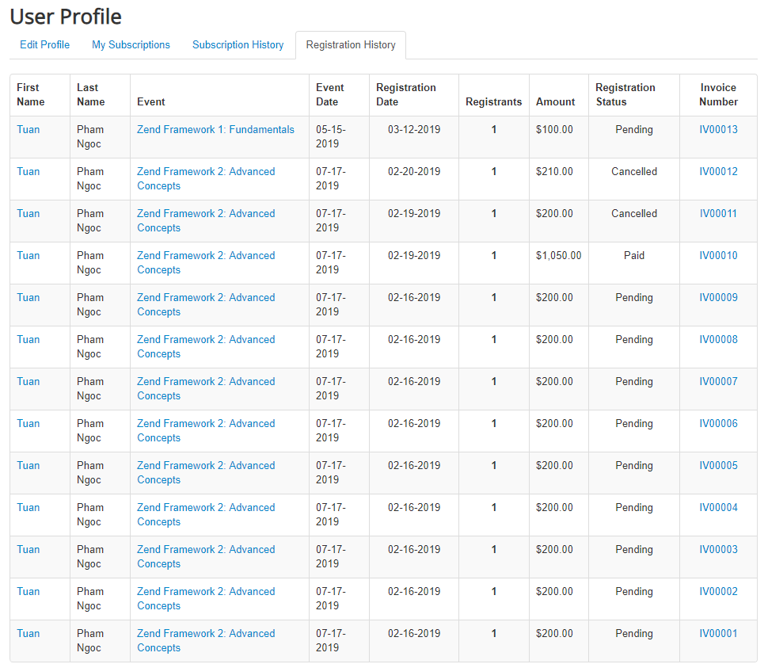

If you use Membership Pro and Events Booking on the same site, this plugin displays a subscriber's Events Booking registration history in their Membership Pro user profile.

To use this plugin, go to **System -> Plugins**, find and publish **Membership Pro - Events Booking Registration History** plugin. Now, when subscriber access to his Membership Pro user profile, he will see his Events Booking Registration History on a new tab on profile

