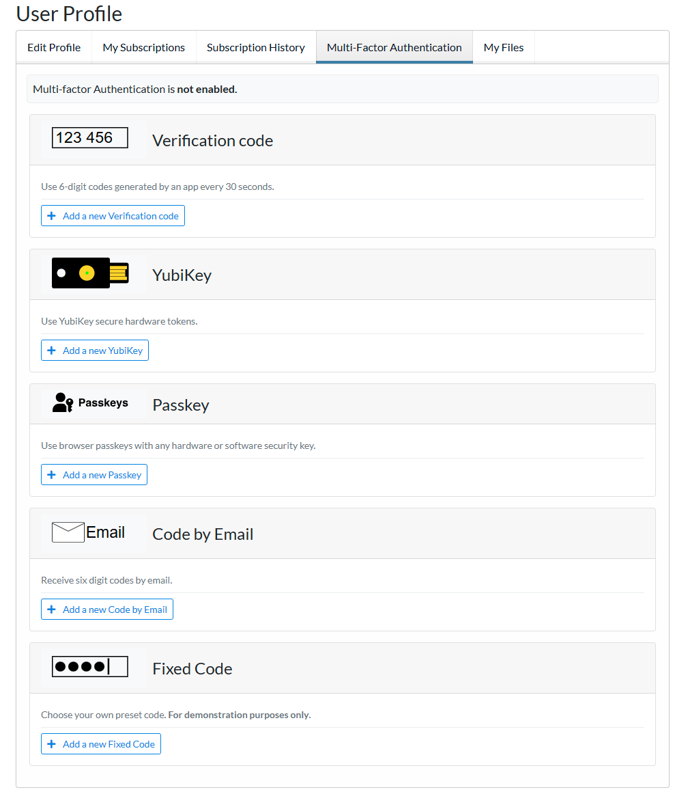

This plugin lets subscribers set up multi-factor authentication for their accounts from their Membership Pro user profile.

To use this plugin, go to **System -> Plugins**, find and publish **Membership Pro - Multi-factor Authentication** plugin. Now, when subscriber access to his Membership Pro user profile, he will see his a new tab on profile to allow setting up Multi-factor Authentication methods for his account.

