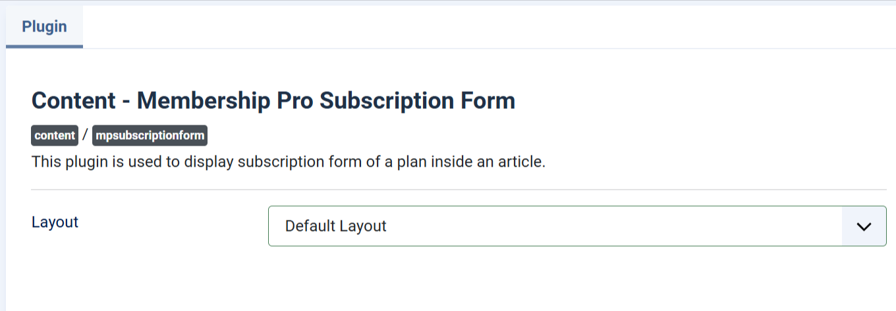

This plugin embeds a plan's subscription form in a Joomla article or on another page that supports Joomla content plugins, such as a K2 item.

If you want to use this feature, please follow the instructions below:

1. Go to **System -> Plugins**, find and enable the plugin **Content - Membership Pro Subscription Form**.
2. Choose the layout you want to use to display subscription form in **Layout** parameter.
3. Now, edit the article you want to insert subscription form of a plan, enter the syntax {mpsubscriptionform [PLAN_ID]}, for example {mpsubscriptionform 2} will display subscription form of a plan with ID = 2 in the article.

